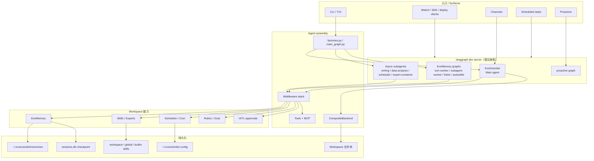
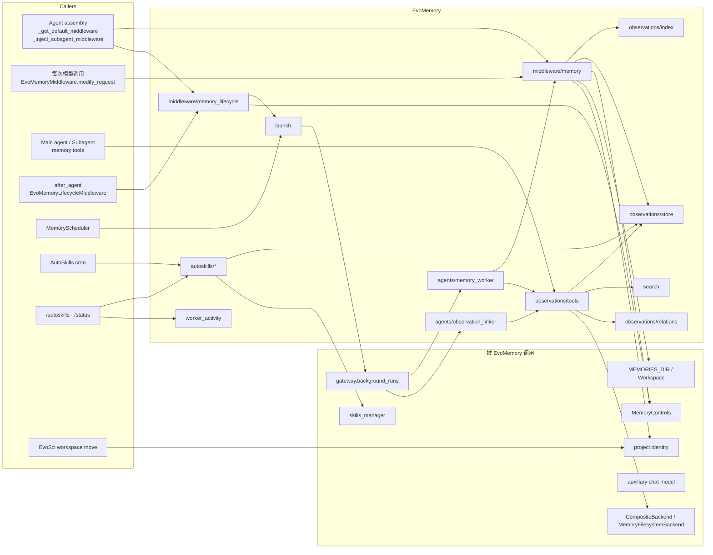

# EvoScientist Memory 模块全景地图（Zoom-Out）

仓库里没有 `CONTEXT.md` 或 `docs/adr/`，所以下面的“领域词汇”是直接从 README、命令名和源码命名中提取的项目实际用语。

## 一句话定位

**EvoMemory 不是独立服务，而是 Workspace 级能力**：它由一对 Middleware（注入 + 生命周期调度）和四张注册在同一个 `langgraph dev` server 上的后台图（turn worker / subagent worker / observation linker / autoskills）组成；Main agent、Subagent、Scheduled task 都是它的调用者。

---

## 领域词汇表（项目实际用语）

| 词汇 | 在本项目中的含义 | 源码锚点 |
|---|---|---|
| **Workspace** | 一个项目文件夹；拥有自己的 skills、memory、experts、AutoSkills | `paths.py:Workspace` |
| **Project** | Workspace 在 server / memory 中的注册身份；记忆 project id 为 `P-<hash>` | `memory/project.py:36` |
| **Session** | 一次 CLI/WebUI 使用过程；**Thread** 是其中的 LangGraph 会话；**Turn** 是一次用户请求对应的 Agent 运行 | `sessions.py`、`MemorySourceType.TURN` |
| **Run folder** | `--mode=run` 的工作子目录；部分图按 run folder 构建 | `SessionDirs`、`FOLDER_GRAPH_IDS` |
| **Main agent** | 主 Agent 图 `EvoScientist` | `EvoScientist.py:build_main_graph` |
| **Subagent** | 同步（进程内 `task`）或异步（独立图）子代理 | `subagents/_factory.py` |
| **Expert** | 以 expert skill 注册的“专家演员”，经 expert container 调度 | `subagents/expert_container*.py` |
| **Skill** | `SKILL.md` 目录，分 workspace / global / builtin 三层 | `tools/skills_manager.py`、`backends.MergedSkillsBackend` |
| **AutoSkills** | 从 EvoMemory 观察簇合成 skill 提案的后台能力 | `memory/autoskills/*` |
| **EvoMemory** | 整个记忆子系统 | `memory/`、`middleware/memory*.py` |
| **Profile memory** | 用户/项目/研究品味/角色画像文件 | `/memories/profile/*.md` |
| **Observation memory** | 带类型和作用域的可复用观察 | `/memories/observations/*.md` |
| **Execution summary** | 子代理运行摘要 | `/memories/executions/*.md` |
| **Memory worker** | 复盘 turn/subagent 轨迹的后台 Agent | `memory/agents/memory_worker.py` |
| **Observation linker** | 只做观察关系链接的后台 Agent | `memory/agents/observation_linker.py` |
| **Background run** | 向 `langgraph dev` 提交短生命周期运行并轮询的通用机制 | `gateway/background_runs.py` |
| **Assistant** | server 上某个 Workspace/Project 的图绑定 | `langgraph_dev/assistants.py` |
| **Gateway** | 运行 Agent 图的客户端抽象（local/server/composite） | `gateway/*` |
| **Checkpointer** | 保存 Thread 消息的 `sessions.db` | `langgraph_dev/checkpointer.py` |
| **Middleware stack** | 包在 Agent 外的钩子链（记忆、上下文、重试、HITL…） | `middleware/` |
| **Channel** | Telegram/Slack/飞书等消息入口 | `channels/` |
| **Scheduled task** | cron 触发的 `scheduler` 图 | `cron/`、`langgraph_dev/server_crons.py` |
| **Proactive** | 主动推送的一次 tick | `proactive/` |

---

## 系统地图：EvoMemory 站在哪一层



**读法**：入口最终都落到“图”；图由 Agent assembly 装配；Memory 只是 Middleware stack 里的一个能力，和 Skills、Scheduler、Rubric、HITL 平级，不是它们的上游。

---

## 调用者地图：谁在什么时候调用 EvoMemory



### 调用者明细

| Caller | 触发时机 | 入口 | 做了什么 |
|---|---|---|---|
| **Agent assembly** | 构建 Main agent / 同步/异步 Subagent 时 | `EvoScientist.py:1045-1125`、`:321-437` | 创建 `EvoMemoryMiddleware` 与 lifecycle middleware，挂到 Middleware stack |
| **每次模型调用** | 每个 Turn 内的每次 LLM 调用 | `middleware/memory.py:859` / `:874` | 读取 Profile、重建 Observation 索引、注入 system message |
| **Main agent / Subagent** | 模型决定调用工具时 | `observations/tools.py` | `search_observations` / `read_memory` / `record_observation` / `link_observations` |
| **Lifecycle** | Turn 或 Subagent 运行结束 | `middleware/memory_lifecycle.py:79` | 压缩轨迹，启动 Memory worker |
| **MemoryScheduler** | worker 完成、或直接写入排队后 | `memory/scheduler.py:68` | 聚合新增 observation ID；无活跃 worker 时启动 Linker |
| **AutoSkills cron** | 每个 Workspace 的定时任务 | `memory/autoskills/schedule.py` | 创建 `evomemory-autoskills` 后台 run |
| **CLI 命令** | 用户执行 `/autoskills`、查看状态栏 | `commands/implementation/autoskills.py`、`cli/status_bar.py` | 列出/审批/拒绝提案；显示 memory worker 状态 |
| **Workspace move** | 用户执行 `EvoSci workspace move` | `langgraph_dev/workspace_move.py:431` | 合并旧 project 的 observations / profile / proposals |

### 被调用方明细

| 依赖 | 用途 |
|---|---|
| `MemoryControls`（`config/settings.py:726`） | 决定 profile / observations / workers / writer 是否启用 |
| `MEMORIES_DIR` / `Workspace`（`paths.py`） | 记忆根目录、项目身份来源 |
| `CompositeBackend` / `MemoryFilesystemBackend`（`backends.py`） | Agent 的 `/memories` 文件访问与写策略 |
| `gateway.background_runs`（`gateway/background_runs.py`） | 启动 Memory worker / Linker 的通用后台运行机制 |
| `_ensure_auxiliary_chat_model`（`EvoScientist.py:189`） | Memory worker 使用的辅助模型 |
| `skills_manager`（`tools/skills_manager.py`） | AutoSkills 批准后安装 skill、通知 skills 变更 |
| `memory/project.py` | `P-<hash>` 项目身份 |

---

## 三条理解轴

### 1. 运行时轴

```text
Surface → Graph → Agent assembly → Middleware stack → Tool → Store → File
```

- Memory 的“读”发生在 **Middleware stack**（模型调用前注入）。
- Memory 的“写”发生在 **Tool**（模型主动）或 **Memory worker**（运行结束后台）。
- Memory 的“维护”发生在 **Linker / AutoSkills**（后台图）。

### 2. 作用域轴

```text
Machine → MEMORIES_DIR (global)
            ├─ profile/                 全局画像
            ├─ observations/global/     跨项目观察
            ├─ observations/projects/P-* 项目观察
            ├─ executions/              子代理执行摘要
            └─ autoskills/             技能提案
Workspace → P-<hash>（git remote / git root / path）
Run folder → 仅影响工作目录，不改变 Memory 作用域
```

### 3. 生命周期轴

```text
模型调用前  → 注入 Profile + Observation 索引
Turn 中     → 模型调用 memory tools / edit_file
Turn 结束   → Lifecycle 启动 Turn worker
Subagent 结束 → Lifecycle 启动 Subagent worker
Worker 完成 → Scheduler 排队 → Linker 链接
定时        → AutoSkills 扫描观察簇 → 提案 → 审批 → Skill
```

---

## 边界：Memory 不负责什么

| 不属于 Memory | 归属模块 |
|---|---|
| Thread 对话历史、断点恢复 | `sessions.py` + `langgraph_dev/checkpointer.py` |
| 上下文窗口压缩、工具结果清理 | `middleware/summarization.py`、`middleware/context_editing.py` |
| Skill 的安装、加载、分层 | `tools/skills_manager.py`、`backends.MergedSkillsBackend` |
| 定时任务的创建与执行 | `cron/`、`scheduler` 图、`langgraph_dev/server_crons.py` |
| 模型选择与 fallback | `llm/`、`middleware/model_fallback.py` |
| Shell 执行与文件工具 | `backends.CustomSandboxBackend`、deepagents 文件工具 |
| 人工审批 | `middleware/ask_user.py`、HITL 配置 |

---

## “我想改 X，从哪看”

| 想改的东西 | 起点 |
|---|---|
| 每次模型调用注入什么 | `middleware/memory.py` 的 `modify_request` / `_memory_context_for_request` |
| 何时启动 Memory worker | `middleware/memory_lifecycle.py` + `MemoryControls.worker_needed` |
| Worker 提炼什么、不提炼什么 | `memory/agents/memory_worker.py` 的 `_MemoryWorkerPromptBuilder` |
| 观察的字段与存储格式 | `memory/observations/store.py` 的 `ObservationFrontmatter` |
| 搜索排序 | `memory/search.py` 的 `_ranked_score` / `_ranked_search_documents` |
| 索引长度与会话公平性 | `memory/observations/index.py` + `DEFAULT_MAX_INLINE_OBSERVATION_INDEX_CHARS` |
| 关系链接 | `memory/observations/relations.py` + `observation_linker.py` 的 prompt |
| 观察簇 → 技能 | `memory/autoskills/candidates.py`、`proposals.py`、`agents/autoskills.py` |
| 项目身份 / 迁移 | `memory/project.py`、`langgraph_dev/workspace_move.py` |
| `/memories` 的读写权限 | `backends.py` 的 `MemoryFilesystemBackend` |
| 记忆相关 CLI | `commands/implementation/autoskills.py`、`cli/status_bar.py`、`cli/commands.py` |

**最小心智模型**：把 EvoMemory 想成“挂在每个 Agent 上的两个 Middleware + 四个后台图 + 一个文件目录”；它的调用者是 Agent assembly、模型调用、工具调用、运行结束 hook 和 cron，而不是某个中心调度器。