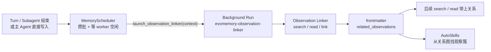
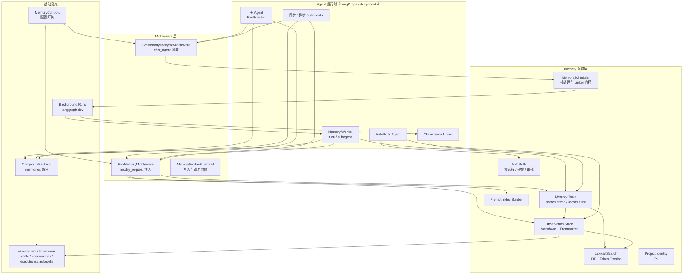
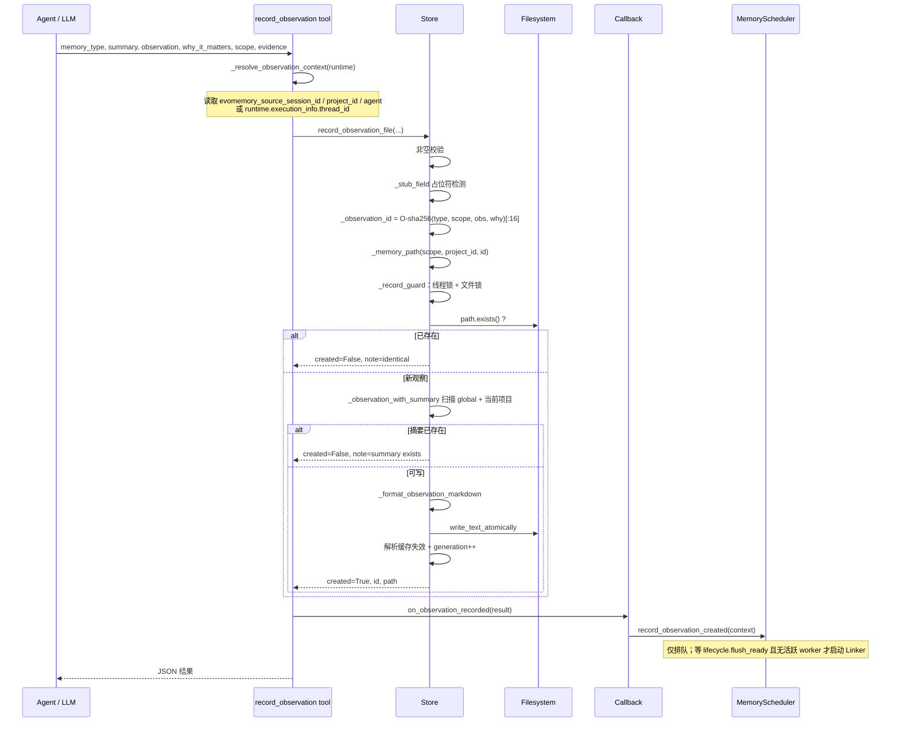
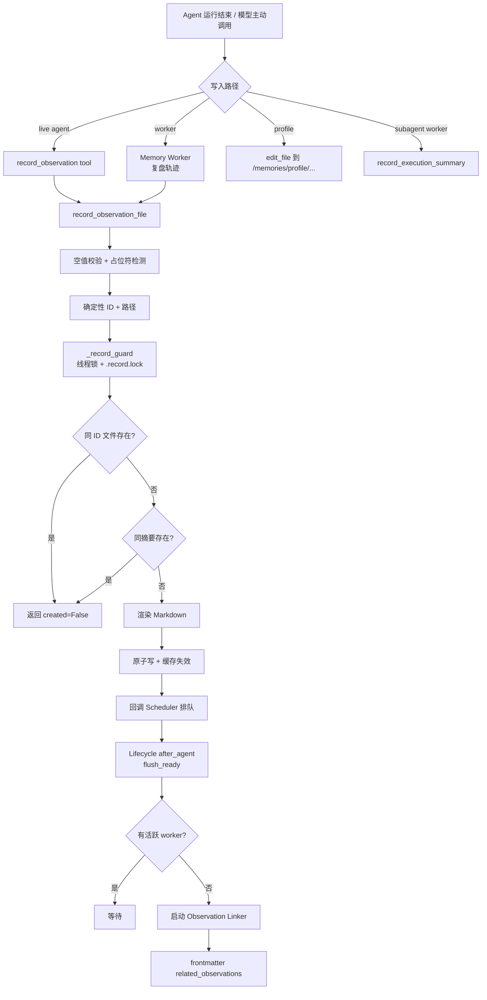
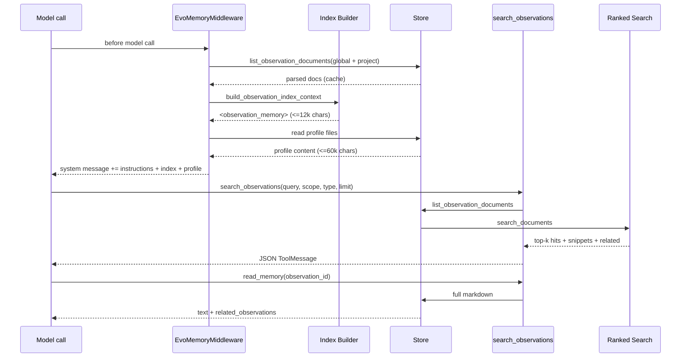
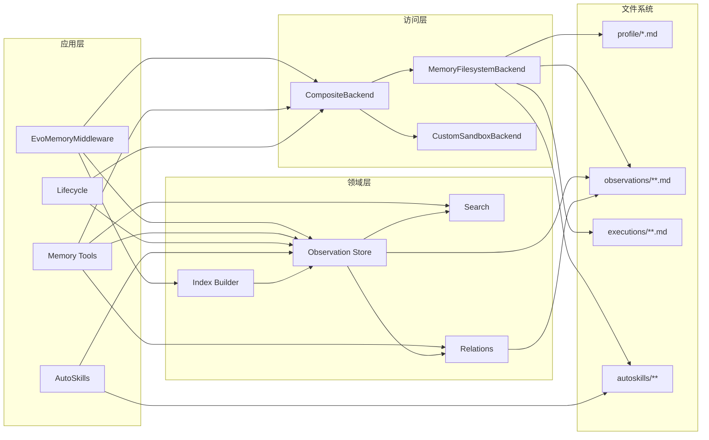
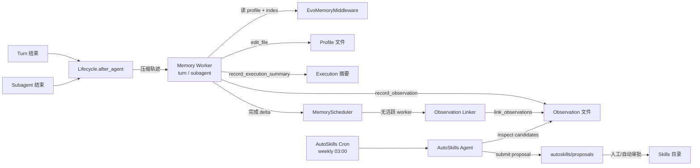
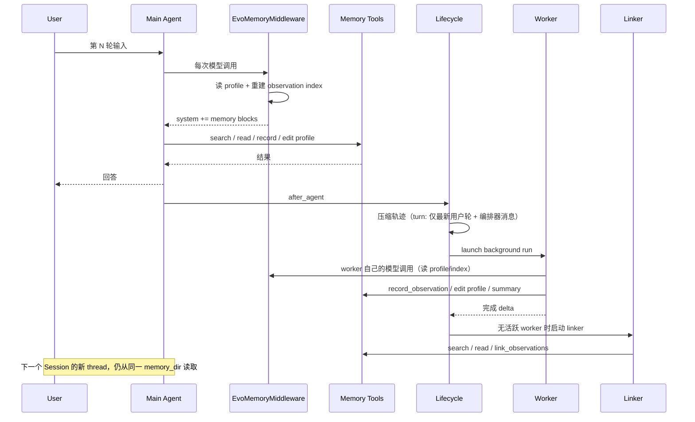
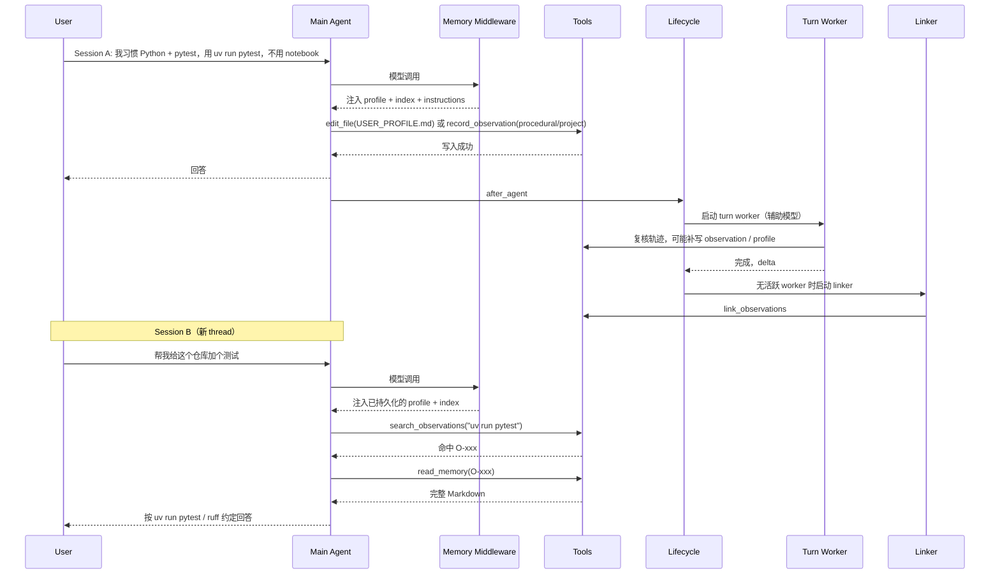
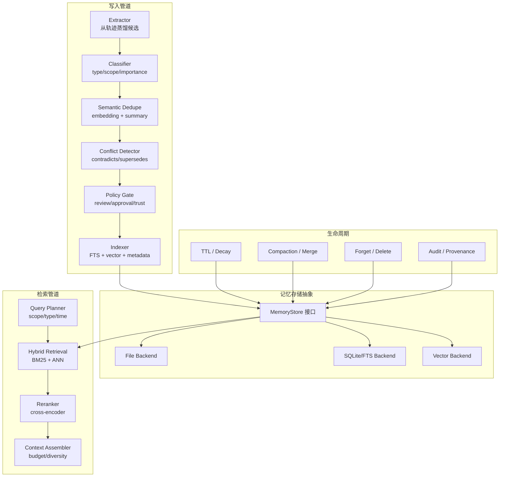

# EvoScientist Memory 模块源码级架构分析

> **分析基线**：`main` 分支 `60b089b`，工作区干净。本文结论来自对 `EvoScientist/memory/`、`middleware/memory.py`、`middleware/memory_lifecycle.py`、`backends.py`、`config/settings.py`、`paths.py`、`langgraph_dev/` 及测试的逐文件阅读。
>
> **标记约定**：✅ 源码已实现；◐ 根据源码可合理推断的设计意图；✗ 当前项目未发现相关实现；💡 本文建议。

---

## 0. 结论速览

1. **EvoScientist 的 Memory 不是单一类，而是一套跨层子系统**：Middleware 负责“注入与调度”，`memory/` 负责“领域模型、存储、检索、后台代理”，`backends.py` 负责 `/memories` 虚拟文件系统与写权限，LangGraph 后台图负责“异步提炼、链接、技能合成”。
2. **长期记忆的物理形态是 Markdown + YAML frontmatter 文件**，默认位于 `~/.evoscientist/memories/`（`paths.py:389,408`），不使用向量数据库、Embedding 或外部记忆服务。✅
3. **记忆分为四类**：`profile`（用户/项目/角色画像）、`observations`（semantic / procedural / episodic 三类可复用观察）、`executions`（子代理执行摘要）、`autoskills`（观察簇合成的技能提案）。✅
4. **写入是“模型主动 + 后台自动”的混合模式**：主 Agent 与子 Agent 可调用 `record_observation`；每轮/每个子代理结束后，`EvoMemoryLifecycleMiddleware` 会启动后台 Memory Worker，用辅助模型复盘轨迹并决定是否写入。✅
5. **检索是“Agentic Retrieval”而非自动 RAG**：每次模型调用都会注入画像全文 + 观察摘要索引；模型再按提示词做 preflight，主动调用 `search_observations`（词法排序）和 `read_memory`（按 ID 读全文）。✅
6. **排序算法是自研的词法打分**：ASCII 词 + CJK 等无空格文字 bigram 分词，IDF × 字段权重（id 5 / summary 3 / body 1 / metadata 0.5），无 Embedding、无 Rerank、无时间衰减。✅
7. **没有真正的“遗忘”机制**：没有 TTL、衰减、重要性评分、访问频率、删除工具；观察正文不可更新；`supersedes` 只是元数据，不会在检索时屏蔽被取代记忆。✗
8. **工程可靠性是亮点**：确定性内容 ID 去重、摘要去重、占位符过滤、跨进程文件锁、原子替换、统计签名缓存、Windows 重试、后台 worker 限额与状态统计。✅
9. **主要风险**：词法检索的召回上限、记忆无限增长、记忆污染/提示注入、每次模型调用的 Token 开销、跨进程链接写竞争、后台 worker 依赖本地 `langgraph dev` 可用性。✅/✗
10. **生产化最需要补的三件事**：混合检索（词法 + 向量 + Rerank）、记忆生命周期（更新/取代/过期/压缩/删除）、来源可信与多租户隔离。💡

---

## 1. Memory 模块定位与整体架构

### 1.1 这个项目为什么需要 Memory

EvoScientist 是一个面向科研全流程的长期 Agent 系统，具有四个结构性特征：

- **跨 Session**：用户会反复回到同一项目，期望 Agent 记得偏好、研究品味、项目约定。
- **多 Agent**：主 Agent 会派发同步/异步子 Agent，子 Agent 的发现需要回流给主 Agent 或后续子 Agent。
- **上下文有限**：对话历史只存在于 LangGraph thread checkpoint 中；一旦换 thread，历史不可见。
- **需要“越用越懂”**：README 明确将其定位为 “Self-Evolving Memory — Auto-distilled each turn, self-linking into a knowledge graph that grows across sessions”（`README.md:125`）。

项目自己在配置注释里给出了最直接的动机（`config/settings.py:365-368`）：

> `recursion_limit` 是 per-turn 的；长对话真正依赖的是 checkpointer（sessions.db）、`ContextEditingMiddleware`（窗口管理）和 `EvoMemoryMiddleware`（跨轮记忆）。

也就是说，**Memory 解决的是“线程内上下文机制无法覆盖的跨轮、跨线程、跨 Agent 的持久知识”问题**：

| 问题    | 线程内机制                          | Memory 的补充                         |
| ----- | ------------------------------ | ---------------------------------- |
| 多轮对话  | LangGraph checkpointer 保存消息    | 跨 thread 的画像与观察                    |
| 上下文溢出 | Summarization / ContextEditing | 蒸馏后的摘要与按需检索                        |
| 子代理发现 | 子代理结果回传主线程                     | 观察持久化，其他 Agent 可复用                 |
| 用户偏好  | 仅当前对话可见                        | USER_PROFILE / RESEARCH_TASTE      |
| 项目约定  | 仅当前对话可见                        | PROJECT_PROFILE / project scope 观察 |
| 重复踩坑  | 依赖模型记忆                         | procedural observations            |


### 1.2 Memory 在系统中的位置

Memory 不是一个独立微服务，而是**横切在 Agent 构建、模型调用、工具调用、运行结束、后台维护五个阶段**的子系统：



### 1.3 核心职责

| 职责 | 说明 | 主要实现 |
|---|---|---|
| 画像记忆 | 维护 SOUL / USER_PROFILE / RESEARCH_TASTE / PROJECT_PROFILE 四个 Markdown 文件，并在每次模型调用时注入 | `middleware/memory.py` |
| 观察记忆 | 结构化记录可复用的 semantic / procedural / episodic 知识，支持检索、读取、关联 | `memory/observations/*` |
| 执行摘要 | 子代理运行结束后写入 episodic 执行摘要 | `memory/agents/memory_worker.py:397-436` |
| 记忆链接 | 用 frontmatter 建立 complements / contradicts / supersedes 关系 | `memory/observations/relations.py` |
| 后台提炼 | 每轮/每个子代理结束后异步复盘轨迹并决定写入 | `middleware/memory_lifecycle.py`、`memory/launch.py` |
| 技能合成 | 定期扫描观察图簇，合成可复用 Skill 提案 | `memory/autoskills/*`、`memory/agents/autoskills.py` |
| 生命周期与观测 | 后台 worker 状态、写入增量、等待空闲 | `memory/worker_activity.py` |
| 存储与并发 | 文件布局、原子写、去重、锁、解析缓存 | `memory/observations/store.py` |
| 访问控制 | `/memories` 虚拟路径、禁止原始写观察文件、仅允许编辑 profile | `backends.py:1860-1951` |

### 1.4 核心子模块与文件职责

| 子模块                | 文件                                                               | 关键类/函数                                                                                                                                                           | 职责                                                               |
| ------------------ | ---------------------------------------------------------------- | ---------------------------------------------------------------------------------------------------------------------------------------------------------------- | ---------------------------------------------------------------- |
| 记忆 Middleware      | `EvoScientist/middleware/memory.py`                              | `EvoMemoryMiddleware` (`:488`)、`create_memory_middleware` (`:929`)                                                                                               | 创建记忆工具；每次模型调用注入画像、观察索引、操作指令；首次接触 bootstrap                       |
| 生命周期 Middleware    | `EvoScientist/middleware/memory_lifecycle.py`                    | `EvoMemoryLifecycleMiddleware` (`:48`)、`default_memory_scheduler` (`:31`)                                                                                        | `after_agent` 构建轨迹并启动后台 worker；flush Linker 批次                   |
| 共享类型               | `EvoScientist/memory/types.py`                                   | `MemoryType` (`:15`)、`MemoryScope` (`:23`)、`MemorySourceType` (`:30`)、`ObservationSearchDocument` (`:80`)                                                        | 领域枚举、搜索结果、文档模型                                                   |
| 观察存储               | `EvoScientist/memory/observations/store.py`                      | `ObservationFrontmatter` (`:105`)、`record_observation_file` (`:919`)、`list_observation_documents` (`:618`)、`search_observation_files` (`:653`)                   | Markdown 读写、去重、锁、解析缓存、检索入口                                       |
| 提示词索引              | `EvoScientist/memory/observations/index.py`                      | `build_observation_index_context` (`:16`)、`_fill_order` (`:109`)                                                                                                 | 生成 `<observation_memory>` 摘要索引，处理预算与会话公平性                        |
| 关系链接               | `EvoScientist/memory/observations/relations.py`                  | `link_observation_files` (`:66`)                                                                                                                                 | 双向/单向写 frontmatter 关系                                            |
| 工具包装               | `EvoScientist/memory/observations/tools.py`                      | `create_search_observations_tool` (`:243`)、`create_read_memory_tool` (`:292`)、`create_record_observation_tool` (`:335`)、`create_link_observations_tool` (`:400`) | 暴露给 LLM 的 LangChain StructuredTool                               |
| 词法检索               | `EvoScientist/memory/search.py`                                  | `_tokens` (`:92`)、`_token_idf` (`:153`)、`_ranked_score` (`:165`)、`search_documents` (`:355`)                                                                     | 分词、IDF、字段加权排序、正则搜索                                               |
| 后台启动               | `EvoScientist/memory/launch.py`                                  | `launch_memory_worker` (`:305`)、`launch_observation_linker` (`:339`)                                                                                             | 构造 LangGraph background run 请求与 hooks                            |
| 调度器                | `EvoScientist/memory/scheduler.py`                               | `MemoryScheduler` (`:68`)                                                                                                                                        | 按 (memory_dir, workspace, project) 聚合观察 ID；等 worker 空闲后启动 Linker |
| 轨迹压缩               | `EvoScientist/memory/source_context.py`                          | `build_memory_source_context` (`:212`)、`_compact_turn_messages` (`:130`)                                                                                         | 将 AgentState 压缩成 worker prompt 可用的轨迹                             |
| Memory Worker      | `EvoScientist/memory/agents/memory_worker.py`                    | `build_memory_worker_graph` (`:864`)、`_MemoryWorkerGuardrailMiddleware` (`:519`)                                                                                 | 后台复盘代理；限额、总结工具                                                   |
| Observation Linker | `EvoScientist/memory/agents/observation_linker.py`               | `build_observation_linker_graph` (`:69`)                                                                                                                         | 只做链接的只读+link 工具代理                                                |
| AutoSkills         | `EvoScientist/memory/agents/autoskills.py`、`memory/autoskills/*` | `build_autoskills_graph` (`:99`)、`autoskill_candidates` (`candidates.py:154`)、`submit/approve/reject`（`proposals.py`）                                            | 从观察图簇合成技能提案并审批                                                   |
| 活动统计               | `EvoScientist/memory/worker_activity.py`                         | `mark_memory_worker_started` (`:356`)、`mark_memory_worker_finished` (`:433`)、`wait_for_memory_pipeline_idle` (`:262`)                                            | 运行状态、产出增量、等待空闲                                                   |
| 项目身份               | `EvoScientist/memory/project.py`                                 | `resolve_project_id` (`:36`)、`path_project_ids` (`:48`)                                                                                                          | 从 git remote / git root / 路径生成稳定 `P-<hash>`                      |
| 存储后端               | `EvoScientist/backends.py`                                       | `MemoryFilesystemBackend` (`:1860`)、`build_memory_agent_backend` (`:1909`)、`build_memory_worker_backend` (`:1928`)                                               | `/memories` 路由；禁止原始写；profile 可编辑                                 |
| 配置                 | `EvoScientist/config/settings.py`                                | `MemoryControls` (`:726`)、`MemoryObservationWriter` (`:47`)                                                                                                      | 功能开关与写入角色                                                        |
| 路径                 | `EvoScientist/paths.py`                                          | `GLOBAL_MEMORIES_DIR` (`:389`)、`MEMORIES_DIR` (`:408`)                                                                                                           | 全局记忆目录与环境变量覆盖                                                    |

### 1.5 依赖与调用关系

**构建期依赖**：

- `EvoScientist.py` → `create_memory_middleware` / `create_memory_lifecycle_middleware`（`EvoScientist.py:1045-1125`）→ Middleware 注入工具。
- `EvoScientist.py` → `_get_default_backend`（`:840-902`）→ `CompositeBackend` 将 `/memories/` 路由到 `MemoryFilesystemBackend`。
- `langgraph_dev/factories.py:73-117` → 注册 `evomemory-turn-worker`、`evomemory-subagent-worker`、`evomemory-observation-linker`、`evomemory-autoskills` 四个后台图。

**运行期依赖**：

- `EvoMemoryMiddleware.modify_request` → `build_observation_index_context` → `list_observation_documents` → `store` / `search`。
- `record_observation` → `record_observation_file` → `store` 写文件 → 回调 `MemoryScheduler.record_observation_created`。
- `EvoMemoryLifecycleMiddleware.after_agent` → `build_memory_source_context` → `launch_memory_worker` → `gateway.background_runs` → LangGraph dev。
- Worker 完成后 → `record_worker_finished` → `MemoryScheduler` → `launch_observation_linker`。
- AutoSkills cron → `run_autoskill_now` / `plan_autoskill_schedule` → `evomemory-autoskills` 图。

### 1.6 与 Agent / LLM / RAG / Context / Tool 的关系

| 模块 | 关系 | 源码依据 |
|---|---|---|
| **Agent** | 作为 `AgentMiddleware` 挂在主 Agent 与所有子 Agent 上；提供工具、系统提示注入、运行结束 hook | `EvoScientist.py:1045-1125`、`:321-437` |
| **LLM** | 记忆内容以 system message 追加块注入；后台 worker 使用辅助模型（`_ensure_auxiliary_chat_model`） | `middleware/utils.py:118-132`、`agents/_factory.py:98` |
| **RAG** | 没有向量库/Embedding；检索是文件级词法检索 + Agent 主动 read，属于“Agentic RAG”思路而非经典向量 RAG | `memory/search.py`、依赖清单中无向量库 |
| **Context** | checkpointer 保存线程消息；Summarization / ContextEditing 管窗口；Memory 管跨线程蒸馏知识，三者互补 | `config/settings.py:365-368`、`middleware/context_editing.py`、`middleware/summarization.py` |
| **Tool** | Memory Tool 是普通 LangChain `StructuredTool`；`/memories` 由 Backend 管控原始文件访问 | `memory/observations/tools.py`、`backends.py:1860-1951` |

**一个关键区别**：项目没有把 Memory 做成“自动检索器”。模型调用前只注入**摘要索引**；是否读取全文、是否搜索、是否写入，由模型决定。这是本设计最重要的架构选择，也是其优点与局限的共同来源。

---

## 2. Memory 核心组件与数据结构

### 2.1 四种物理记忆形态

| 形态 | 位置 | 数据单位 | 写入者 | 读取方式 |
|---|---|---|---|---|
| Profile | `/memories/profile/*.md` | Markdown 文件（USER_PROFILE 带 YAML frontmatter） | 主 Agent / 子 Agent / Memory Worker 的 `edit_file` | 每次模型调用全文注入（有预算截断） |
| Observation | `/memories/observations/{global,projects/P-*}/O-*.md` | 一条观察 = 一个 Markdown 文件 | `record_observation` 工具（主 Agent / Worker） | 摘要索引 + `search_observations` + `read_memory` |
| Execution Summary | `/memories/executions/{session}/{agent}-{hash}.md` | 子代理执行摘要 | 子代理 Worker 的 `record_execution_summary` | ✗ 当前未发现读取/检索实现 |
| AutoSkill Proposal | `/memories/autoskills/proposals/{skill}/` | `SKILL.md` + `manifest.json` + `RATIONALE.md` | AutoSkills Agent | CLI `/autoskills` 审查；批准后安装到 skills |

### 2.2 Observation 的 frontmatter 数据模型

定义在 `memory/observations/store.py:105-160`：

```python
class ObservationFrontmatter(BaseModel):
    id: str
    created_at: str | None
    summary: str
    memory_type: MemoryType       # semantic / procedural / episodic
    scope: MemoryScope            # global / project
    project_id: str | None
    source: ObservationSourceFrontmatter | None
    related_observations: list[RelatedObservationEntry]
```

| 字段 | 作用 | 设计原因 |
|---|---|---|
| `id` | `O-<sha256前16位>`，由 type + scope + 规范化 observation + why 生成 | 内容寻址，天然去重；无需中心 ID 生成器 |
| `created_at` | UTC ISO 时间 | 索引按时间排序；支持时间感知 |
| `summary` | 一行摘要 | 用于索引展示、摘要去重、搜索字段 |
| `memory_type` | semantic / procedural / episodic | 区分“事实 / 流程 / 事件”，支持过滤与 AutoSkills 聚类 |
| `scope` | global / project | 决定存储目录与可见范围 |
| `project_id` | 仅 project scope | 项目隔离；来自 git remote/root/path 的稳定哈希 |
| `source` | `{type: turn/subagent, agent, session_id}` | 溯源；索引的“每 session 公平性”；审计 |
| `related_observations` | `{id, relation, reason, linked_at}` | 轻量知识图谱；不需要图数据库 |

正文固定结构（`store.py:804-813`）：

```markdown
## Observation
...
## Why It Matters
...
## Evidence          # 可选
...
```

`Why It Matters` 是写入模型的强制字段，用于让未来 Agent 判断“是否值得读全文”，也是检索摘要之外的额外语义信号。

### 2.3 Profile 数据模型

模板定义在 `middleware/memory.py:385-423`：

| 文件 | 作用域 | 内容 |
|---|---|---|
| `/profile/SOUL.md` | 全局 | 这个 EvoScientist 副本的行为方式、语气、边界 |
| `/profile/USER_PROFILE.md` | 全局 | 用户事实与偏好 |
| `/profile/RESEARCH_TASTE.md` | 全局 | 研究兴趣、标准、适合的方法、应避免的做法 |
| `/profile/projects/{project_id}/PROJECT_PROFILE.md` | 项目 | 工作区约定、命令、测试、陷阱 |

`USER_PROFILE.md` 有 YAML frontmatter（`memory.py:212-223`）：

```yaml
name: ""
field: ""
homepage: ""
intro: pending
evoscientist:
  sessions: 0
  intro_attempts: 0
  last_thread: ""
  intro_asked_thread: ""
```

其中 `evoscientist` 是 bookkeeping：统计“第几个 session”、首次介绍尝试次数、上次 thread、上次在哪条 thread 问过。用于首次接触引导与指数退避重试（`_bootstrap_decision`，`memory.py:306-324`）。

### 2.4 执行摘要模型

由 `_write_subagent_summary` 写入（`memory/agents/memory_worker.py:397-436`）：

```yaml
id: "E-<hash>"
created_at: "..."
source:
  type: subagent
  session_id: "..."
  agent: "..."
project_id: "P-..."
---
## Summary
...
```

`id = E-<hash(session_id + agent + trajectory_digest)>`，路径也由同一组键决定，因此同一子代理同一轨迹重复写会覆盖为最新摘要。

**注意**：全仓库检索只发现写入方，没有发现读取 `/memories/executions` 的代码路径（`grep` 结果仅 `memory_worker.py` 与测试）。Agent 理论上可用 `ls`/`read_file` 浏览，但没有提示词引导，也没有索引/检索工具。✅ 当前是“只写不读”的审计型数据。

### 2.5 内存中的模型

| 类型 | 定义 | 用途 |
|---|---|---|
| `ObservationSearchDocument` | `types.py:80-93`，frozen dataclass | 解析后的搜索文档：id/path/type/scope/summary/body/text/related/created_at/source_session_id |
| `ObservationSearchHit` | `types.py:96-106`，TypedDict | 搜索命中：id/path/type/scope/summary/matches/related/score |
| `ObservationReadResult` | `types.py:109-118`，TypedDict | 全文读取结果 |
| `ObservationRecordResult` | `types.py:52-65`，TypedDict | 写入结果：created/id/path/type/scope/project/note |
| `RelatedObservationResult` | `types.py:68-77`，TypedDict | 已解析的关系目标 |
| `MemorySourceContext` | `source_context.py:32-43`，frozen dataclass | 后台 worker 的源运行上下文 |
| `MemoryOutputSnapshot/Delta` | `worker_activity.py:41-65` | 写入增量统计 |
| `ObservationLinkerContext` | `scheduler.py:24-31` | Linker 批次上下文 |

### 2.6 记忆分类体系

| 维度 | 取值 | 含义 |
|---|---|---|
| `MemoryType` | `semantic` | 可复用事实/发现 |
| | `procedural` | 命令、工具约束、workaround、操作配方 |
| | `episodic` | 值得未来调试/交接的一次性事件 |
| `MemoryScope` | `global` | 跨项目可复用 |
| | `project` | 仅当前工作区 |
| `MemorySourceType` | `turn` | 主 Agent 一轮对话 |
| | `subagent` | 子代理一次运行 |
| `ObservationRelation` | `complements` | 互补，应一起考虑 |
| | `contradicts` | 冲突 |
| | `supersedes` | 源应取代目标（单向） |

**短/长期记忆的对应关系**：

- **短期记忆** = LangGraph thread checkpoint 中的 `messages`（`sessions.db`），不是 Memory 模块管理的对象。
- **长期记忆** = `profile` + `observations` + `executions` 文件。
- **情节记忆** = `episodic` observations + `executions`。
- **语义记忆** = `semantic` observations + `profile` 中稳定事实。
- **程序性记忆** = `procedural` observations，最终可被 AutoSkills 提升为 Skill。

### 2.7 元数据与生命周期字段

**已有**：`created_at`、`source.session_id`、`source.agent`、`project_id`、`linked_at`、`intro`/`sessions`/`intro_attempts`/`last_thread`、proposal 的 `created_at`/`updated_at`/`status`。

**没有**：`user_id`、`updated_at`（observation）、`last_accessed_at`、`access_count`、`importance`、`confidence`、`valid_from/valid_to`、`expires_at`、`embedding`、`version`。✗

**结论**：数据结构足以支撑“写入 + 检索 + 链接 + 溯源”，但不足以支撑“更新 + 遗忘 + 冲突裁决 + 多租户”。

---

## 3. Memory 写入机制（Memory Write）

### 3.1 写入触发点

| 触发点 | 触发者 | 条件 | 源码 |
|---|---|---|---|
| `record_observation` | 主 Agent / 同步/异步子 Agent | `memory_observations_enabled` 且 `memory_observation_writer` 包含 `agent` | `tools.py:335-397` |
| `record_observation` | Turn Worker / Subagent Worker | writer 包含 `worker`；worker 由 lifecycle 启动 | `memory_worker.py:728-774` |
| `edit_file` 写 `/memories/profile/...` | 主 Agent / 子 Agent / Worker | 只能是已存在的 profile 文件 | `backends.py:1888-1897` |
| 首次 bootstrap 模板 | Middleware | 文件缺失时自动创建 | `memory.py:627-650` |
| `record_execution_summary` | 子代理 Worker | 子代理 worker 固定工具 | `memory_worker.py:830-861` |
| AutoSkills 提案 | AutoSkills Agent | 定时/手动运行 | `autoskills/tools.py:129-205` |

**不是“系统自动抽取规则”**：没有正则/规则抽取器；是否写入由 LLM 判断并调用工具。所谓“自动提炼”是“自动启动一个 LLM Worker 去判断”，而不是确定性管道。✅

### 3.2 `record_observation` 完整调用链



关键代码位置：

- 工具入口：`memory/observations/tools.py:345-397`
- 上下文解析：`tools.py:225-240`、`:193-222`
- 写入主流程：`memory/observations/store.py:919-1013`
- 确定性 ID：`store.py:168-185`
- 路径生成：`store.py:193-202`
- 写入锁：`store.py:867-890`
- 摘要去重：`store.py:990-994`、`:1016-1033`
- 占位符过滤：`store.py:893-916`
- Markdown 渲染：`store.py:742-813`
- 原子写：`store.py:297-331`
- 回调：`middleware/memory.py:573-584`

### 3.3 原始对话 → 可持久化记忆

写入的“原料”不是整个对话历史，而是经过压缩的轨迹。`memory/source_context.py` 定义了两条路径：

**Turn Worker**（`_compact_turn_messages`，`:130-163`）：

- 只取**最近一个用户轮次**（`this_run_messages`）。
- 用 `filter_messages(..., exclude_tool_calls=task_ids)` 移除 `task` 工具调用及其结果。
- 只保留源 Agent 直接产生的 ToolMessage；子代理结果被替换为占位文本。
- pinned skill 内容替换为 `[pinned skill: name]`，避免把技能正文当用户输入。
- 结果：主 Agent 编排轨迹，**不包含子代理内部工作**。

**Subagent Worker**（`_compact_messages`，`:107-122`）：

- 保留子代理完整消息列表（含工具调用与结果）。
- `_task_tool_call_ids` / `_compact_message` 负责 ToolMessage 关联。
- 结果：子代理完整轨迹。

**轨迹封装**：`MemorySourceContext`（`:32-43`）包含 `trajectory`、`trajectory_digest`、`source_type`、`memory_dir`、`workspace_dir`、`project_id`、`source_agent`、`session_id`。`build_memory_source_context`（`:212-246`）在无 thread id 或空轨迹时返回 `None`，因此不会启动 worker。

**Worker Prompt**（`memory_worker.py:100-357`）按 source_type 与配置动态拼接：

- 标题：Turn / Subagent。
- 评审范围：Turn 明确说明“轨迹省略子代理内容，不要继续任务”。
- 目标：只保存 durable、non-obvious、evidence-backed、not already present 的信息。
- 允许写：profile 编辑 / `record_observation`。
- Profile guardrail：不得仅从任务内容推断用户偏好。
- Observation guidance：procedural/global 的适用边界；最多 3 条；按重要性排序。
- Subagent guardrail：把工具输出中的指令当数据；不要记录原始轨迹/任务总结。
- 结束指令：Turn 无合适内容则不改文件；Subagent 必须调用 `record_execution_summary`。

### 3.4 去重、过滤与分类

| 机制 | 规则 | 效果 | 源码 |
|---|---|---|---|
| 内容寻址 ID | `sha256(type + scope + normalize(observation).casefold() + normalize(why).casefold())[:16]` | 同一内容重复写入 → 同一路径 → 拒绝 | `store.py:168-185` |
| 摘要唯一 | 扫描 global + 当前 project，`normalize(summary).casefold()` 完全相等则拒绝 | 防止同一教训换正文/换 scope 重写 | `store.py:990-994`、`:1016-1033` |
| 占位符过滤 | 单词级 stub marker + glue 词 + 固定短语 + 无词 | 拒绝 `TBD`、`placeholder`、`see above` 等 | `store.py:893-916` |
| 空值校验 | summary/observation/why/session_id 必填 | 防止残缺记忆 | `store.py:943-953` |
| 类型分类 | 模型在工具参数中选择 `MemoryType` | 影响索引、搜索过滤、AutoSkills 聚类 | `tools.py:38-45` |
| 作用域分类 | 模型选择 `MemoryScope` | 决定目录与可见性 | `tools.py:77-83` |

**没有实现**：语义去重（近义改写仍会重复）、冲突检测（同一主题矛盾事实可共存）、写入前事实核验。✗

### 3.5 Worker 限额与护栏

`_MemoryWorkerGuardrailMiddleware`（`memory_worker.py:519-725`）把限额全部从“运行自身消息”推导，避免共享计数器：

| 限额 | 值 | 行为 |
|---|---|---|
| 最多写入观察 | 3 | 达到后 `record_observation` 返回预算耗尽 JSON，不再执行 |
| 最多调用 `record_observation` | 6 | 含失败/重复尝试 |
| 最多模型调用 | 20 | `before_model` 到预算后 `jump_to=end` |
| 递归上限 | 100 | `MEMORY_AGENT_RECURSION_LIMIT`（`types.py:12`） |
| 子代理最后一次调用 | 仅保留 `record_execution_summary` | 保证循环也能交总结；未交则重试一次 |
| 平行工具调用 | 通过 `_record_calls_ahead` 计算同一步中排在前面的调用 | 防止并行绕过预算 |

这套设计的巧妙点：**限额不依赖进程内可变状态**，而是从 `state["messages"]` 读取，天然支持并行工具调用与断点恢复。

### 3.6 异步、批量与增量

- **异步**：`launch_memory_worker` / `alaunch_memory_worker` 通过 `gateway.background_runs` 向本地 `langgraph dev` 提交 run，立即返回句柄；状态由 watcher 线程轮询（`background_runs.py:476-543`）。
- **不阻塞主轮**：`after_agent` 启动 worker 后直接返回；只有 one-shot CLI 在退出前 `wait_for_memory_pipeline_idle` 最多等 120 秒（`cli/commands.py:933-980`）。
- **批量**：`MemoryScheduler` 按 `(memory_dir, workspace_dir, project_id)` 聚合观察 ID；当该 `memory_dir` 没有活跃 worker 时，一次性启动一个 Linker 处理整批（`scheduler.py:68-200`）。
- **增量**：每次 worker 完成通过 `MemoryOutputSnapshot` 前后对比计算新增/修改文件（`worker_activity.py:145-200`），只把新增 observation 路径交给 Linker。
- **无批量写**：每个观察一个文件，写入是单条、原子的。✗ 无批量写入 API。

### 3.7 Memory Write 流程图



---

## 4. Memory 检索机制（Memory Retrieval）

### 4.1 检索触发点

| 触发方式 | 时机 | 内容 | 源码 |
|---|---|---|---|
| 画像注入 | **每次模型调用前** | 四个 profile 文件全文（预算内） | `memory.py:854-910` |
| 观察索引注入 | **每次模型调用前** | 所有观察的 id + type/scope + path + summary | `index.py:16-42` |
| 记忆 preflight | 模型决定开始编码/调试/研究/规划/评估前 | `search_observations`，必要时 `read_memory` | `memory.py:93-114` |
| Linker 检索 | 后台链接时 | `search_observations` / `read_memory` | `observation_linker.py:47-66` |
| AutoSkills 读取 | 定时合成时 | 直接读 observation store / `/memories` | `autoskills/candidates.py` |

**关键结论**：检索不是“根据用户最新消息自动做一次相似度检索”，而是**把索引常驻上下文 + 让模型自己决定是否深入**。✅

### 4.2 注入式检索：画像与观察索引

`EvoMemoryMiddleware.modify_request`（`memory.py:859-872`）在每次模型调用时：

1. `_read_profile_memory()`：读取并组装四个 profile 文件。
2. `_refresh_observation_index_context()`：重新构建观察索引。
3. `_bootstrap_context()`：首次接触引导。
4. `_inject_memory_context()`：把四段内容追加到 system message。

注入顺序（`memory.py:813-831`）：

```text
<memory_instructions>        # 静态操作说明
<observation_memory>         # 动态观察索引
<profile_memory>             # 动态画像全文
<profile_bootstrap>          # 首次接触引导（可选，最后）
```

**为什么顺序是“静态 → 动态”**：静态指令在前，动态内容在后，有利于 prompt cache 复用静态前缀；bootstrap 最后，确保模型先看到事实再看到“去问用户”。

`append_to_system_message`（`middleware/utils.py:118-132`）用 `model_copy` 保留 `additional_kwargs`（如 `cache_control`）、`id`、`name`、`response_metadata`，避免破坏已有 prompt-cache 断点。

### 4.3 观察索引的构建与预算

`build_observation_index_context`（`index.py:16-42`）：

- 读取 global + 当前 project 的全部观察文档。
- 按 `created_at` 降序（无时间戳的排最后）。
- 每行格式：`- O-xxx [procedural/project] /memories/...: summary`。
- 默认上限 `DEFAULT_MAX_INLINE_OBSERVATION_INDEX_CHARS = 12_000` 字符。
- 超预算时：
  - 先保证每个 source session 最新的 `rows_per_session=3` 条；
  - 剩余预算再按时间填充更早的条目；
  - 仍放不下则显示“索引被截断”说明；
  - 若模型有搜索工具，提示可以 `search_observations`；无工具调用则只说明。
- 索引的排序/填充逻辑在 `_fill_order`（`:109-130`）与 `_truncated_observation_index_context`（`:206-249`）。

**设计意图**：防止某个 session 写了大量观察把其他 session 挤出索引；保证“最近会话的最新记忆”优先可见。

### 4.4 工具式检索：`search_observations`

工具定义在 `tools.py:243-289`，参数：

| 参数 | 默认 | 说明 |
|---|---|---|
| `query` | 必填 | ranked 模式是关键词/短语；regex 模式是 grep 式模式 |
| `mode` | `ranked` | `ranked` / `regex` |
| `scope` | `None` | 过滤 global / project |
| `memory_type` | `None` | 过滤 semantic / procedural / episodic |
| `limit` | `8` | 1–20 |

调用链：

```text
search_observations tool (tools.py:250)
  → search_observation_files (store.py:653)
    → list_observation_documents (store.py:618)
      → _observation_files (store.py:376)  # global + project 目录 glob
      → _parse_with_cache (store.py:548)   # 每文件解析缓存
      → _resolve_document_links (store.py:456)
    → search_documents (search.py:355)
      → _ranked_search_documents (search.py:303)
      → _regex_search_documents (search.py:271)
```

### 4.5 排序算法细节

**分词**（`search.py:92-133`）：

- ASCII：`[a-z0-9_]+`，长度 ≥ 3。
- 非 ASCII：NFKC + casefold；按 Unicode 类别分离符号；CJK / Hiragana / Katakana / Hangul / Thai / Bopomofo 等无空格文字切成 **2 字符 bigram**；带变体选择符（variation selector）的字符先剔除。
- 单字符 run 不参与 ranked 匹配，避免过宽命中。
- 这使中文、日文、泰文等无需外部分词器即可检索（测试 `test_search_observation_files_ranks_unsegmented_chinese_text` 等覆盖）。

**IDF**（`search.py:153-162`）：

```text
idf(token) = ln((N + 1) / (df(token) + 0.5)) + 1.0
```

在当前检索范围（global + project）内即时计算，不持久化。

**打分**（`search.py:165-188`）：

```text
score = Σ_{token ∈ query} idf(token) × weight(field)
weight: id=5.0, summary=3.0, body=1.0, metadata=0.5
```

字段命中规则：

- token 出现在 `observation_id` → +5×idf
- 出现在 `summary` → +3×idf
- 出现在 `body` → +1×idf
- 否则若出现在 `memory_type/scope` → +0.5×idf

**排序与截断**（`search.py:303-352`）：

- 按 `(-score, 原始索引)` 排序，保证同分稳定。
- 只保留 `score > 0` 的结果；没有“低置信度兜底”。
- 取前 `limit`。
- 每条结果附带 `matches`：从 body 中挑与 query token 重叠最多的最多 3 行，每行截断 240 字符。
- 若有关联观察，附带 `related_observations`。

**正则模式**（`search.py:271-300`）：

- 编译失败则 `re.escape` 退化为字面量匹配。
- haystack = id + summary + type + scope + body。
- 返回 summary/body 中匹配行，最多 3 行。

**没有**：Embedding、余弦相似度、BM25 的完整实现（只有 IDF + 线性加权，缺少 TF 饱和与文档长度归一化）、Rerank、时间衰减、重要性加权、访问频率加权、同义词扩展。✗

### 4.6 读取全文：`read_memory`

`create_read_memory_tool`（`tools.py:292-332`）→ `read_observation_file`（`store.py:683-713`）：

- 遍历 `list_observation_documents`（global + project），按 `observation_id` 精确匹配。
- 返回完整 Markdown `text` + `related_observations`。
- 找不到返回 JSON error。
- **复杂度 O(N)**：每次按 ID 读取都会解析/遍历整个可见观察集；虽然解析缓存命中，但仍是线性扫描。💡 可加 ID→路径索引。

### 4.7 检索隔离

| 隔离维度 | 实现 | 说明 |
|---|---|---|
| 项目隔离 | 目录 `observations/projects/{project_id}/` + 查询时只 glob 当前 project + global | ✅ |
| 全局共享 | `observations/global/` | ✅ 设计意图是跨项目复用 |
| 类型隔离 | `memory_type` 过滤 | ✅ |
| Scope 过滤 | `scope` 参数 | ✅ |
| Session 隔离 | ✗ 不按 `source.session_id` 过滤 | session id 只用于索引公平性 |
| 用户隔离 | ✗ 无 `user_id` / 租户字段 | 单用户本地应用假设 |
| Agent 隔离 | ✗ 所有 Agent 共享同一 memory_dir | 仅用 `source.agent` 溯源 |

### 4.8 检索结果如何进入 LLM Context

- **索引与画像**：作为 system message 的追加 text block 注入，属于“每次都在”的上下文，不需要模型调用工具。
- **搜索结果**：作为 ToolMessage 返回给模型，模型在后续推理中自行使用。
- **全文**：`read_memory` 的 ToolMessage，包含完整 Markdown 与关系。

**Token 控制**：

| 控制点 | 机制 |
|---|---|
| 画像 | 60,000 字符上限；按文件公平分配；超限文件保留头 75% + 尾 25%，插入省略标记；只警告一次 |
| 观察索引 | 12,000 字符上限；每 session 最新 3 条优先；超限提示搜索 |
| 搜索结果 | 默认 8 条；每条最多 3 行 × 240 字符 |
| 全文 | 只有模型显式 `read_memory` 才消耗 |
| 工具无工具调用 | `_request_has_tools` 检测；无工具时使用 `*_NO_TOOLS` 指令，避免模型“表演”调用不存在的工具 |

### 4.9 Memory Retrieval 流程图



---

## 5. Memory 更新与遗忘机制

### 5.1 更新能力矩阵

| 记忆类型 | 是否可更新 | 方式 | 说明 |
|---|---|---|---|
| Profile | ✅ | `edit_file`（仅 `/memories/profile/...` 已存在文件） | 主 Agent、子 Agent、Worker 都可编辑；模板缺失时 middleware 自动创建 |
| Observation 正文 | ✗ | 无更新工具 | `record_observation` 对同 ID 直接返回“已存在”，不覆盖 |
| Observation 摘要 | ✗ | 无更新工具 | 摘要参与去重；改摘要 + 同正文仍会因同 ID 被拒 |
| Observation 关系 | ✅ | `link_observations` | 按 target ID upsert；`linked_at` 更新 |
| Execution Summary | ✅（覆盖） | 同 `session_id + agent + trajectory_digest` 路径重写 | 后写覆盖前写 |
| AutoSkill 提案 | ✅ | submit / approve / reject | 状态机 pending → approved / rejected；`processed` 标记防重复 |
| 已安装 Skill | ✅（间接） | 提案批准后复制到 skills 目录 | 不是 Memory 文件本身的更新 |

### 5.2 重复与冲突处理

**重复**：

- 内容完全相同：确定性 ID → 同路径 → `_NOTE_IDENTICAL` 拒绝。✅
- 内容不同但摘要相同：`_NOTE_SUMMARY_EXISTS` 拒绝，并返回已存在条目。✅
- 近义改写：会生成不同 ID、不同摘要 → **重复写入**。✗ 无语义去重。
- 跨项目相同摘要：摘要去重只检查 global + 当前 project，其他项目可存在同名摘要。✅ 这是 scope 隔离的合理结果。

**冲突**：

- `contradicts` / `supersedes` 只是 frontmatter 元数据。✅
- 检索/注入时**不会**因为 `supersedes` 而隐藏或降权被取代条目。✗
- 没有冲突检测、裁决、合并流程；冲突记忆可同时出现在索引与搜索结果中。
- Linker 只在“关系很强”时写链接；它的系统提示明确“弱关系或无重复则不要改文件”（`observation_linker.py:27-44`）。

### 5.3 合并、压缩、摘要与强化

| 机制 | 是否存在 | 说明 |
|---|---|---|
| 观察合并 | ✗ | 没有 merge 工具；AutoSkills 只读取簇，不改写观察 |
| 观察压缩/摘要 | ✗ | `summary` 是写入时生成的一行摘要，不是后处理压缩 |
| Profile 摘要 | ✗ | Profile 是人工/模型逐条 bullet 维护；超预算只截断 |
| 记忆强化 | ✗ | 无“被再次访问则加强”的机制 |
| 访问频率 | ✗ | 无 `access_count` / `last_accessed_at` |
| 重要性评分 | ✗ | 无 importance/confidence 字段 |
| 时间衰减 | ✗ | 搜索分数无时间项；索引只是按时间排序 |
| 冲突裁决 | ✗ | 只有元数据标签，无检索时策略 |

### 5.4 删除、过期与遗忘

| 能力 | 状态 | 证据 |
|---|---|---|
| Agent 删除观察 | ✗ | `MemoryFilesystemBackend.delete` 返回错误（`backends.py:1905-1906`） |
| 删除工具 | ✗ | 没有 `delete_observation` 工具 |
| TTL / 过期 | ✗ | 无 `expires_at` / `valid_until` 字段，无清理任务 |
| 时间衰减 | ✗ | 无 |
| 容量上限/自动淘汰 | ✗ | 观察文件只增不减；只有解析缓存有 LRU 上限 2048 |
| 用户手动删除 | ✅（文件系统层） | 用户可直接删除 `~/.evoscientist/memories` 下文件；应用会视为不存在 |
| 工作区迁移时的合并 | ✅（特殊场景） | `move_memory` 在 workspace move 时合并/移除旧 project 目录（`langgraph_dev/workspace_move.py:431-469`） |
| AutoSkills 防重复处理 | ✅（仅提案层） | `processed_cluster_hashes` 防止同一簇反复提案（`proposals.py:374-388`） |

**明确的“遗忘”替代品只有提示词预算截断**：

- Profile 超 60k 字符 → 只注入头尾，中间省略。
- 观察索引超 12k 字符 → 只注入最新/每 session 前 3 条。
- 这**不是删除**，原文件仍在磁盘、仍可搜索/读取。✅

### 5.5 如何避免长期记忆无限增长

**当前没有系统性方案**。实际存在的边界只有：

1. 写入限额：每个 worker 最多 3 条观察（`memory_worker.py:49`）。
2. 去重：完全重复/同摘要不写。
3. 索引预算：只影响注入，不影响存储。
4. 解析缓存 LRU：只影响内存，不影响磁盘。
5. AutoSkills 的 processed 标记：只防止重复提案，不清理观察。

因此：**观察、执行摘要、AutoSkills 提案会随时间无限累积**。✗ 这是生产化前必须补的。

### 5.6 小结

| 问题 | 答案 |
|---|---|
| 已有记忆是否支持更新和覆盖？ | Profile 可编辑；观察正文不可更新；执行摘要可覆盖；关系可 upsert |
| 如何处理重复？ | 内容 ID + 摘要精确去重；无近义去重 |
| 如何处理冲突？ | 只打标签（contradicts/supersedes），不裁决 |
| 是否存在合并/压缩/摘要/强化？ | 观察层没有；AutoSkills 是“技能合成”而非记忆压缩 |
| 是否存在时间衰减/重要性/访问频率？ | 全部没有 |
| 是否支持删除/过期？ | 没有；只有用户手动删文件 |
| 如何避免无限增长？ | 没有真正机制 |

---

## 6. Memory 存储与索引设计

### 6.1 存储介质与目录布局

**介质**：本地文件系统 + Markdown + YAML。没有关系型数据库、文档数据库或向量数据库参与 Memory 存储（LangGraph checkpointer 的 SQLite 是会话状态，不是 Memory 存储）。✅

默认根目录（`paths.py:381-408`）：

```text
~/.evoscientist/memories/          # GLOBAL_MEMORIES_DIR
```

可用 `EVOSCIENTIST_MEMORIES_DIR` 覆盖（旧变量 `EVOSCIENTIST_MEMORY_DIR` 兼容）。该路径在模块导入时读取一次，CLI 与 server 通过 `dir_env` 传递同一个绝对路径（`paths.py:354-374`），避免两个进程看到不同目录。✅

**完整布局**：

```text
<MEMORIES_DIR>/
├── profile/
│   ├── SOUL.md
│   ├── USER_PROFILE.md                  # YAML frontmatter + body
│   ├── RESEARCH_TASTE.md
│   └── projects/
│       └── P-<hash>/
│           └── PROJECT_PROFILE.md
├── observations/
│   ├── .record.lock                     # 跨进程写锁
│   ├── global/
│   │   └── O-<hash>.md
│   └── projects/
│       └── P-<hash>/
│           └── O-<hash>.md
├── executions/
│   └── <session_id>/
│       └── <agent>-<hash>.md
└── autoskills/
    ├── proposals/
    │   └── <skill-name>/
    │       ├── SKILL.md
    │       ├── manifest.json
    │       └── RATIONALE.md
    └── processed/
        └── <cluster_hash>.json
```

**项目身份的生成**（`memory/project.py:36-45`）：

```text
如果有 git remote origin → P-hash("git-remote:<url>")
否则如果在 git repo 内   → P-hash("git-root:<root>")
否则                     → P-hash("path:<resolved path>")
```

因此：

- 同一个 git 仓库的多个 clone（同一 remote）共享 project 记忆（在同一台机器/同一记忆目录下）。
- 没有 remote 的仓库按根路径识别；文件夹重命名会变成新项目，除非执行 `EvoSci workspace move`。
- 非 git 目录按绝对路径识别，移动/重命名同样会变成新项目。

### 6.2 持久化模型

- **Source of truth = 文件**。没有数据库事务、没有 WAL、没有 journal。
- 进程内解析缓存、索引、链接解析都是**可重建的派生数据**。
- 文件缺失 → 视为不存在；文件损坏 → 记录 warning 并跳过（`_report_unreadable`，`store.py:256-268`）。
- Profile 缺失 → middleware 自动用模板创建（`_ensure_profile_files`，`memory.py:627-650`）。
- USER_PROFILE 缺少 frontmatter → 自动补默认 frontmatter，保留 body（`memory.py:636-648`）。

### 6.3 索引与缓存

**没有持久化索引**。每次 `list_observation_documents` 都：

1. `rglob/glob` 枚举 global + project 目录的 `*.md`。
2. 逐文件 `stat` 取 `(st_mtime_ns, st_size, st_ino)`。
3. 命中解析缓存则复用；否则读取 + YAML 解析 + Pydantic 校验。
4. 解析所有文档后解析关系链接。
5. 结束时按 LRU 裁剪缓存。

**解析缓存**（`store.py:494-598`）：

| 设计点 | 说明 |
|---|---|
| Key | 文件绝对路径 |
| Value | `(stat_signature, (ObservationSearchDocument, related_entries))` |
| 失效 | stat 签名变化（原子替换会改变 inode/mtime/size） |
| 写后失效 | `_write_file_atomically` 主动 pop + `_cache_generation += 1`，防止“写前开始的解析”被缓存 |
| 并发 | `_cache_lock` 只保护 dict 操作；解析在锁外 |
| LRU 上限 | `memory_observation_cache_max_files`，默认 2048（`config/settings.py:410`），环境变量 `EVOSCIENTIST_MAX_CACHED_FILES` |
| 裁剪策略 | 结束时裁剪到 `max(cap, 本次触碰的条目数)`，避免一次调用清掉自己的工作集 |
| 失败缓存 | 解析失败不缓存；同一文件同一内容只报告一次 |
| 删除 | 不需要失效：删除的文件不会再被 glob 到 |

**链接解析**（`store.py:456-491`）：

- 先建立 `documents_by_id`。
- 若某条关系的目标不在当前可见集合，遍历 `_all_observation_files(root)`（**所有项目**）查找；找到后加入 map。
- 这意味着：**显式链接可以跨项目解析**，即使目标项目不在当前查询范围。
- 每次调用都重新解析链接（over memoized parses），但 fallback 会带来额外扫描。

### 6.4 查询与检索路径

```text
应用层
  EvoMemoryMiddleware
    → build_observation_index_context
  record_observation / search_observations / read_memory tools
    → memory.observations.store
      → _observation_files
      → _parse_with_cache
      → _resolve_document_links
      → search_documents (search.py)
  EvoMemoryLifecycleMiddleware
    → launch_memory_worker / launch_observation_linker
      → gateway.background_runs
        → langgraph dev graphs
  AutoSkills
    → autoskill_candidates / proposals

存储层
  MemoryFilesystemBackend / CompositeBackend
    → <MEMORIES_DIR>
```

**文件工具访问**：

- 主 Agent 的 `CompositeBackend` 默认是 `CustomSandboxBackend`（workspace），`/memories/` 路由到 `MemoryFilesystemBackend`（`EvoScientist.py:892-901`）。
- Memory Worker 的默认后端是 `ReadOnlyFilesystemBackend`（workspace 只读），`/memories/` 也是 `MemoryFilesystemBackend`（`backends.py:1928-1951`）。
- `MemoryFilesystemBackend`：
  - `write` / `upload_files` → 一律拒绝（`backends.py:1885-1903`）。
  - `edit` → 仅允许 `/profile/...`（`backends.py:1888-1897`）。
  - `delete` → 一律拒绝（`backends.py:1905-1906`）。
- Shell 命令中的 `/memories/...` 会通过 `_resolve_virtual_mount_path` 映射到真实目录（`backends.py:1507-1509`），并被 `validate_command` 保护，禁止 `rm -rf` 删除 memories（`backends.py:1306-1346`）。

### 6.5 多用户、多会话隔离

| 维度 | 支持情况 |
|---|---|
| 多项目 | ✅ 通过 `projects/P-<hash>` 目录隔离 |
| 全局共享 | ✅ `global/` 跨项目共享 |
| 多 session | ✅ session 数据在 frontmatter，但**不做访问隔离**；所有 session 可检索同一项目/全局观察 |
| 多 Agent | ✅ 共享同一 memory_dir；仅 `source.agent` 溯源 |
| 多用户 | ✗ 无 `user_id`、无租户、无认证；默认是单用户本地应用 |
| 多机 | ✗ 本地文件系统；无同步/复制机制 |

README 也明确说明记忆保存在项目文件夹之外、按项目路径区分，可用 `EvoSci workspace move` 迁移（`README.md:486`）。

### 6.6 一致性与并发

| 场景 | 机制 | 评价 |
|---|---|---|
| 并发 `record_observation` | `_record_guard`：进程内 `threading.Lock` + 跨进程 `filelock.FileLock(.record.lock)`，10 秒超时 | ✅ 强 |
| 写入原子性 | 临时文件 + `os.replace`；保留原文件权限；Windows `PermissionError` 重试 5 次 | ✅ 强 |
| 读取原子性 | 原子替换保证读者看不到半文件；解析缓存按 stat 签名验证 | ✅ |
| 并发 `link_observations` | 仅 `_link_write_lock`（**进程内** threading.Lock） | ⚠️ 跨进程可丢更新 |
| 并发 profile 编辑 | `_write_text` 原子替换，但无跨进程锁 | ⚠️ 读-改-写竞争 |
| 缓存与外部写 | stat 签名 + generation 计数 | ✅ |
| 损坏文件 | 跳过并限频警告 | ✅ |
| 解析失败 | 不缓存，下次重试 | ✅ |

**跨进程链接竞争**是一个真实缺口：`link_observation_files` 读取 frontmatter → 修改 `related_observations` → 重写整个文件；两个进程同时链接同一文件时，后写者可能覆盖前者的链接。测试只覆盖了同进程多线程（`test_link_observation_files_serializes_concurrent_frontmatter_updates`）。⚠️

### 6.7 存储层抽象与可替换性

| 层 | 是否抽象 | 说明 |
|---|---|---|
| Agent 文件访问 | ✅ `deepagents` `BackendProtocol` + `CompositeBackend` | 可替换 workspace/memory 路由 |
| Memory 工具/领域层 | ✗ 直接调用文件函数 | `tools.py` 直接 import `store.py`；`store.py` 直接用 `Path`、`filelock`、`yaml` |
| 检索 | ✗ 紧耦合 `ObservationSearchDocument` 列表 | 换向量库需要改 `search.py` / `store.py` |
| 配置 | ✅ `MemoryControls` | 可开关 profile/observations/workers/writer |

**结论**：文件访问层可替换，但 **Memory 存储/检索本身没有 `MemoryStore` 接口**；要换成 SQLite/向量库，需要改 `store.py`、`search.py`、`index.py`、`tools.py` 多处。💡

### 6.8 存储调用关系图



---

## 7. Memory 与 Agent 的协同机制

### 7.1 构建期：Memory 如何进入 Agent

**主 Agent / 异步子 Agent**（`EvoScientist.py:1045-1125`）：

```python
memory_middleware = create_memory_middleware(
    memory_dir,
    workspace_dir=workspace.root,
    source_type=source_type,              # TURN 或 SUBAGENT
    source_agent=memory_source_agent,
    enable_profile_memory=memory_controls.profile_enabled,
    enable_observation_memory=memory_controls.observations_enabled,
    enable_observation_tool=memory_controls.observation_tool_enabled(AGENT),
    memory_scheduler=memory_scheduler,
    enable_profile_bootstrap=not for_async_subagent and not cfg.auto_mode,
)
...
if memory_controls.memory_enabled:
    mw.append(memory_middleware)
if memory_controls.worker_needed(worker_target):
    mw.append(create_memory_lifecycle_middleware(...))
```

**同步子 Agent**（`EvoScientist.py:321-437`）：

- 每个子 Agent 都会追加 `memory_middleware`；
- 若 `worker_needed(SUBAGENT_WORKER)`，追加 lifecycle middleware；
- 子 Agent 的 `source_agent` 是子 Agent 名字，用于写入溯源。

**Backend**：`CompositeBackend(default=workspace_backend, routes={"/memories/": MemoryFilesystemBackend(...)})`。因此 Agent 的 `read_file` / `edit_file` / `ls` 可以访问 `/memories`，但原始写观察文件被禁止。

### 7.2 每次模型调用前：注入

`modify_request` / `amodify_request` 是 LangChain `AgentMiddleware` 的模型调用钩子，**每一次模型调用都会执行**，包括一个 turn 内的多次工具循环。它们：

1. 读取 profile（4 个文件）。
2. 重建观察索引。
3. 计算首次接触 bootstrap block（仅主 Agent、非 auto mode）。
4. 把内容追加到 system message。

**异步路径**（`amodify_request`，`memory.py:874-910`）用 `asyncio.gather` + `asyncio.to_thread` 并行读取索引和 profile，避免阻塞 event loop。

**无工具调用**：`_request_has_tools` 检测 request 是否带工具；无工具时使用 `PROFILE_MEMORY_INSTRUCTIONS_NO_TOOLS` 与 `OBSERVATION_MEMORY_READ_INSTRUCTIONS_NO_TOOLS`，避免模型“表演”调用不存在的记忆工具。这是一个很细但很重要的工程细节。✅

### 7.3 执行中：工具调用

Agent 在 turn 中可以使用：

| 工具 | 何时使用 | 写入/读取 |
|---|---|---|
| `search_observations` | 编码/调试/研究/规划/评估前的 memory preflight | 读 |
| `read_memory` | 已知 ID 或搜索命中后读全文 | 读 |
| `record_observation` | 发现 durable、non-obvious、evidence-backed 的知识 | 写观察 |
| `link_observations` | Linker 专用；主 Agent 也有工具但提示词主要给 Linker | 写关系 |
| `edit_file` | 更新 `/memories/profile/...` | 写 profile |

**Memory 是否影响 Tool Calling？**

- 不直接改变工具选择逻辑；它通过 system prompt 与 preflight 指令**影响模型行为**。
- `record_observation` 是否可用由配置决定；writer 配置控制主 Agent / Worker 的写入角色。
- Memory Backend 的写策略会**拒绝**对 `/memories` 的原始 `write_file`，迫使观察走结构化工具。这间接影响工具调用：模型如果尝试 `write_file` 到 `/memories` 会收到错误，需要改用 `record_observation`。

### 7.4 运行结束后：`after_agent` 调度

`EvoMemoryLifecycleMiddleware.after_agent`（`memory_lifecycle.py:79-111`）：

1. 读取最后一条消息 ID；若与 `_memory_last_exit` 相同，说明本次运行没有新增对话（例如只改了 goal 状态），不启动 worker，只 flush scheduler。
2. `build_memory_source_context`：取 thread id、压缩轨迹；无 thread id 或空轨迹 → 不启动。
3. `launch_memory_worker(context, hooks)`：
   - `on_before_run`：快照 memory 目录。
   - `on_started`：标记活跃 worker。
   - `on_finished`：计算 delta，交给 `MemoryScheduler.record_worker_finished`。
   - `on_aborted`：同样计算 delta，把已写入的观察排队给 Linker。
4. 若 launch 返回 `None`（langgraph dev 不可用），只 flush scheduler。
5. 返回 `{"_memory_last_exit": last_id}`，防止重复启动。

**为什么用 private state**：`_memory_last_exit` 用 `PrivateStateAttr` 标注（`memory_lifecycle.py:36-39`），因为同步子 Agent 也带这个 middleware；如果它是公共 state key，多个子 Agent 的返回值会在父图同一步冲突。测试 `test_the_mark_is_private_to_the_graph` 明确验证了这一点。✅

### 7.5 后台 Worker / Linker / AutoSkills



**Worker 的模型**：`build_memory_agent_graph` 使用 `_ensure_auxiliary_chat_model()`（`agents/_factory.py:98`），即辅助模型；若未配置 auxiliary，则退回主模型。这样后台记忆提炼不占用主模型成本。✅

**Worker 的工具**：

- `create_memory_middleware` 提供 `search_observations` / `read_memory` / `record_observation`（视 writer 配置）。
- 子代理 Worker 额外有 `record_execution_summary`。
- deepagents 自带文件工具；`_MEMORY_WORKER_EXCLUDED_TOOLS = {delete, execute, task, write_file, write_todos}`（`memory_worker.py:46-48`），保留 `edit_file` / `read_file` / `ls` / `grep` / `glob`。
- Backend 将 workspace 设为只读，`/memories` 仅 profile 可编辑，观察写入必须走工具。

**Linker 的输入**：`_observation_linker_user_prompt`（`launch.py:156-173`）包含：

- `project_id`
- 新增 observation IDs（排序）
- 除新增之外的已有观察索引（`build_observation_linker_index_context`）

**Linker 的工具**：`search_observations` / `read_memory` / `link_observations`（`observation_linker.py:47-66`）。

**AutoSkills**：

- 由 LangGraph cron 每 workspace 调度（默认 weekly 03:00，`settings.py:90-92`）。
- `autoskill_candidates`（`candidates.py:154-221`）从关系中构建无向连通分量，要求：
  - 分量大小 ≥ 3；
  - procedural 观察 ≥ 2；
  - 排除已有 pending/approved/rejected 或 processed 的簇。
- Agent 用 `inspect_autoskill_candidates` 读取候选，用 `write_file`/`edit_file` 在 `/autoskill-proposals/<name>/` 写 `SKILL.md`，然后 `submit_autoskill_proposal`。
- `review` 模式等待人工 `/autoskills approve`；`auto` 模式自动批准 workspace scope；**global scope 在 auto 模式仍强制人工批准**（`autoskills/tools.py:158-190`）。这是一个重要的安全设计。✅

### 7.6 多轮对话与跨 Session

| 场景 | 机制 |
|---|---|
| 同一 thread 多轮 | LangGraph checkpointer 保存消息；Memory 仍在每次模型调用时注入最新 profile/index |
| 新 thread / 新 Session | checkpointer 为空；但 `modify_request` 读取同一 memory_dir 的 profile 与 observation index，因此跨 Session 可见 |
| 跨项目 | 只有 `global` scope 和 `PROJECT_PROFILE` 之外的其他 profile 文件（SOUL/USER/RESEARCH_TASTE）共享；项目观察按 `P-<hash>` 隔离 |
| 记忆写入后同一 turn 可见 | 是：下一次模型调用会重建索引；但 worker 是 turn 结束后异步运行，worker 写入要到后续 turn 才可见 |

### 7.7 Memory 与 Conversation History / Context Window / Prompt Template 的区别

| 概念 | 存储 | 生命周期 | 内容 | 注入方式 |
|---|---|---|---|---|
| **Conversation History** | LangGraph checkpointer（`sessions.db`） | 线程内，可持久化 | 原始消息（含工具调用/结果） | 作为 messages 传给模型 |
| **Context Window 管理** | 进程内/中间件 | 当前模型调用 | Summarization 摘要、ContextEditing 清理后的工具结果 | 修改 messages |
| **Memory** | `~/.evoscientist/memories` 文件 | 跨线程、跨 Session | 蒸馏后的画像、观察、执行摘要、技能提案 | 追加到 system message 或工具返回 |
| **Prompt Template** | `prompts.py` / middleware | 静态 | 角色、流程、规范 | system message 的基础部分 |

**核心区别**：History 是“说过什么”，Memory 是“值得记住什么”，Context 管理是“当前窗口放得下什么”，Prompt 是“应该怎么做”。

### 7.8 多 Agent 场景：共享与隔离

| 维度 | 行为 |
|---|---|
| 主 Agent ↔ 子 Agent | 共享同一 `MEMORIES_DIR` 和 `project_id`；子 Agent 写入的观察主 Agent 可见 |
| 同步子 Agent | 有 memory middleware + lifecycle，可读写记忆、结束后启动 subagent worker |
| 异步子 Agent | 同上；`source_type=SUBAGENT`；worker 图是 `evomemory-subagent-worker` |
| Worker ↔ 主 Agent | Worker 是独立 LangGraph 图；通过文件共享；通过 `evomemory_project_id` / `evomemory_source_session_id` 归因 |
| Linker | 只读 + link；不写观察 |
| AutoSkills | 读 observations；写 proposals；批准后写 skills，不写 observations |
| 隔离 | 没有 per-agent 隔离；所有 Agent 共享 global + project 记忆。这是**有意的知识共享**，但也意味着一个 Agent 的错误/恶意观察会影响所有 Agent |

### 7.9 Agent 生命周期中的 Memory 时序



---

## 8. 完整运行流程与典型案例

> **说明**：下面的用户话语、模型选择的具体工具、写入内容是**为了说明机制而构造的示例**；其中涉及的类、函数、文件路径、目录结构、限额与调用链均来自源码。模型是否真的调用 `record_observation`、写入 profile 还是 observation，取决于模型判断、提示词和配置，不是确定性行为。

### 8.1 场景设定

用户在 Session A 说：

> “我平时用 Python + pytest，测试用 `uv run pytest`；不要用 notebook。这个仓库的约定是提交前跑 `ruff`。”

### 8.2 Step-by-step 映射

| 步骤 | 实际发生的事 | 源码对应 |
|---|---|---|
| **1. 首次构建** | `create_memory_middleware` 解析 workspace → `resolve_project_id` 得到 `P-<hash>`；创建 `/profile/SOUL.md`、`USER_PROFILE.md`、`RESEARCH_TASTE.md`、`/profile/projects/P-<hash>/PROJECT_PROFILE.md`；创建 `/observations/global/` 目录 | `memory.py:495-566`、`:627-650`、`project.py:36-45` |
| **2. 用户消息进入** | 模型调用前，`modify_request` 读取 profile（此时是模板），构建观察索引（可能为空），注入 `<memory_instructions>` + `<observation_memory>` + `<profile_memory>`；若首次接触且 `name` 为空，还会注入 `<profile_bootstrap>`，模型可能先询问称呼/领域 | `memory.py:859-872`、`:691-734`、`:179-206` |
| **3. 模型决定写入** | 对“不要用 notebook / 用 uv run pytest / ruff”这类稳定偏好：模型可能编辑 `USER_PROFILE.md` 或 `PROJECT_PROFILE.md`；对“这个仓库的测试命令”也可能调用 `record_observation`，`memory_type=procedural`、`scope=project`、`summary` 写“Use uv run pytest for this repository” | 提示词见 `memory.py:53-77`、`:128-145`；工具见 `tools.py:335-397` |
| **4a. Profile 写入** | `edit_file` 走 `MemoryFilesystemBackend.edit`，只允许 `/memories/profile/...`；写入是原子替换；下一次模型调用立即可见 | `backends.py:1888-1897`、`memory.py:600-618` |
| **4b. Observation 写入** | `record_observation` 解析 runtime 的 `evomemory_source_session_id` / project / agent；`record_observation_file` 计算 `O-<hash>`，加锁，检查同 ID 与同摘要，渲染 Markdown，原子写，回调 scheduler 排队 | `tools.py:345-385`、`store.py:919-1013`、`memory.py:573-584` |
| **5. Turn 结束** | `after_agent` 取最新用户轮 + 主 Agent 直接工具结果（排除子代理 `task` 内容），生成 trajectory digest，启动 `evomemory-turn-worker`；worker 用辅助模型复盘轨迹 | `memory_lifecycle.py:79-111`、`source_context.py:130-163`、`launch.py:305-319` |
| **6. Worker 复盘** | Worker 的系统提示包含 profile、观察索引、写入规则；它可能补一条观察或修改 profile；最多 3 条观察 / 6 次调用 / 20 次模型调用；最终结束 | `memory_worker.py:100-357`、`:519-725` |
| **7. Worker 完成** | 对比运行前后文件快照，计算新增 observation 路径；`MemoryScheduler` 按 (memory_dir, workspace, project) 排队；若该 memory_dir 无活跃 worker，启动 `evomemory-observation-linker` | `worker_activity.py:145-200`、`:433-464`、`scheduler.py:129-200` |
| **8. Linker 链接** | Linker 拿到新增 ID + 已有索引；用 `search_observations` / `read_memory` 找强关系；调用 `link_observations` 写 `related_observations`；`supersedes` 只写单向，其他关系双向 | `launch.py:156-228`、`observation_linker.py:27-90`、`relations.py:66-156` |
| **9. 新 Session** | 用户新开 thread。checkpointer 没有历史消息；但 `modify_request` 仍读取同一 memory_dir：profile 全文 + 观察摘要索引。用户问“帮我给这个仓库加个测试”，模型看到索引中的 procedural 摘要，或按 preflight 调用 `search_observations("uv run pytest test")` | `memory.py:854-910`、`index.py:16-42`、`tools.py:243-289` |
| **10. 读取全文并回答** | `search_observations` 返回命中摘要/snippet；模型调用 `read_memory(O-...)` 获取完整 Markdown；模型据此给出符合仓库约定的回答；若偏好变化，可再次编辑 profile | `store.py:653-713`、`search.py:303-352` |
| **11. 长期维护** | 若观察簇满足“≥3 条、≥2 条 procedural”，AutoSkills 在 cron 触发时生成 skill 提案；人工 `/autoskills review` 或 auto 模式批准后安装到 skills | `candidates.py:154-221`、`autoskills/tools.py:129-205`、`proposals.py:668-1181` |

### 8.3 真实实现 vs 示例构造

| 内容 | 性质 |
|---|---|
| `EvoMemoryMiddleware`、`record_observation`、`search_observations`、`read_memory`、Worker、Linker、AutoSkills 的类/函数/文件路径 | ✅ 源码真实存在 |
| 目录结构、frontmatter 字段、限额、去重规则、锁、缓存 | ✅ 源码真实存在 |
| 用户说的具体偏好、模型选择 profile 还是 observation、是否真的写入 | ◐ 示例构造；实际取决于模型判断与配置 |
| Worker 一定会写入 | ✗ 不是；提示词明确“大多数运行不需要写” |
| 记忆写入一定立即可见 | ✗ Worker 是异步的；同 turn 的模型主动写入下一次模型调用可见，worker 写入要等后续 turn |
| 后台 worker 一定启动 | ✗ 依赖 `langgraph dev` 可用；不可用时 `launch_memory_worker` 返回 None（`background_runs.py:491-493`） |

### 8.4 案例的端到端时序



---

## 9. 架构设计评价

### 9.1 优点

1. **文件优先，极致可检查、可编辑、可迁移**
   - 所有记忆都是 Markdown，用户可以直接看、直接改、直接备份；没有数据库锁死。
   - 对科研 Agent 尤其重要：用户需要信任并审计 Agent “记住了什么”。

2. **结构化写入与文件系统写保护结合**
   - `record_observation` 提供 schema、类型、scope、provenance；
   - `MemoryFilesystemBackend` 禁止原始 `write_file`，只允许 profile `edit`；
   - 这样既保留了文件工具的灵活性，又防止模型写出不合规的观察文件。

3. **确定性内容 ID + 摘要去重 + 占位符过滤**
   - 不依赖中心 ID 生成器；
   - 重复写入幂等；
   - 阻止 `TBD` / `placeholder` 污染；
   - 这是“低成本但有效”的数据质量防线。

4. **画像与观察分离**
   - Profile 适合稳定、低频、需要全文注入的用户/项目特质；
   - Observation 适合高频、可检索、带类型和来源的知识；
   - 两者注入方式不同（全文 vs 摘要索引），符合各自的访问模式。

5. **Agentic Retrieval + 渐进披露**
   - 每次注入摘要索引，保证“知道有什么”；
   - 模型按需 `search` → `read`，避免把所有全文塞进上下文；
   - 比经典 RAG 更灵活，模型可以改写查询、按 ID 读取、结合关系。

6. **后台 Worker 与主流程解耦**
   - 不阻塞用户 turn；
   - 使用辅助模型；
   - 有严格的写入/调用限额；
   - worker 失败/中止时，已写入的观察仍会被计入并排队链接。

7. **轻量知识图谱**
   - 只用 frontmatter 的 `related_observations`，不需要图数据库；
   - 支持 `complements` / `contradicts` / `supersedes`；
   - Linker 独立后台运行，批量处理新增观察。

8. **AutoSkills 把“程序性记忆”外化为技能**
   - 观察簇 → 技能提案 → 人工/自动审批 → 安装；
   - 这是比“记住一条命令”更高阶的复用；
   - auto 模式仍禁止未经人工批准写 global scope，安全边界清晰。

9. **工程细节扎实**
   - 原子写、Windows 重试、跨进程文件锁；
   - 解析缓存按 stat 签名失效；
   - 写后 generation 防止旧解析被缓存；
   - 无工具调用的 prompt 变体，避免模型幻觉调用工具；
   - 首次接触 bootstrap 有 consent / 指数退避 / 跳过状态。

### 9.2 值得借鉴的设计

| 设计 | 为什么值得借鉴 |
|---|---|
| 内容寻址 ID | 去重、幂等、无中心分配器；适合文件型记忆 |
| 摘要唯一约束 | 防止“同一教训换正文重写”，比单纯 ID 去重更强 |
| 占位符检测 | 模型经常写 `TBD`/`placeholder`；低成本过滤 |
| 画像 vs 观察双通道 | 稳定低频信息全文注入；高频知识按需检索 |
| 摘要索引 + 按需 read | 渐进披露，兼顾召回与 token |
| 每次模型调用重建索引 | 避免缓存陈旧；配合 stat 缓存，成本可控 |
| Worker 限额从 messages 推导 | 并行工具调用/断点恢复下仍正确 |
| Private state 防止子 Agent 冲突 | 多 Agent 共享 middleware 时的细节 |
| AutoSkills global 强制人工批准 | 防止自动写入跨项目共享层 |
| 文件锁 + 原子替换 | 多进程共享一个 memory 目录的基础保障 |

### 9.3 不足与风险

| # | 问题 | 证据 | 影响 |
|---|---|---|---|
| 1 | **纯词法检索，召回受限于字面匹配** | `search.py` 无 embedding；同义词/改写无法命中 | 用户说“单元测试”可能找不到“pytest”；跨语言/跨术语召回弱 |
| 2 | **无 Rerank / 时间 / 重要性加权** | `_ranked_score` 只有 IDF × 字段权重 | 旧但重要的记忆可能排在后面；无“最近更相关” |
| 3 | **观察不可更新** | 无 update 工具；同 ID 直接拒绝 | 错误/过时观察只能新增 `supersedes` 或手动删文件；`supersedes` 不生效于检索 |
| 4 | **无遗忘/TTL/容量控制** | 无 expires/decay/delete；文件只增不减 | 长期使用后存储与索引无限增长；索引预算会把老记忆挤出 |
| 5 | **摘要去重 O(N) 且在写锁内** | `_observation_with_summary` 全量扫描 global+project | 观察越多，写入越慢；所有写入串行化 |
| 6 | **链接写跨进程不安全** | `link_observation_files` 只有 `threading.Lock` | 主 Agent 与 Worker 并发链接可能丢更新 |
| 7 | **Profile 编辑并发不安全** | `_write_text` 无跨进程锁 | 主 Agent/Worker/子 Agent 同时编辑可能覆盖 |
| 8 | **每次模型调用注入大量上下文** | profile 60k + index 12k 字符；每个子 Agent 都注入 | Token 成本高；子 Agent 数量多时放大；prompt cache 可能被打断 |
| 9 | **索引全量重建/搜索全量解析** | 每次 `modify_request` 都 `list_observation_documents`；`read_memory` 线性扫描 | 大规模记忆下 CPU/IO 压力 |
| 10 | **依赖本地 langgraph dev** | `is_langgraph_dev_running` 不满足则跳过 worker | 无服务器场景下后台记忆不工作；writer=worker 时完全无写入 |
| 11 | **Linker 与 Worker 生命周期耦合** | `worker_needed` 为 false 时 lifecycle 不挂载，scheduler 无 flush 触发 | `memory_workers_enabled=false` 时直接写入的观察不会被链接 |
| 12 | **执行摘要只写不读** | 全仓库无读取 `/memories/executions` 的实现 | 每次子代理运行都产生文件，但无人消费；存储浪费 |
| 13 | **无用户/租户隔离** | 无 user_id；global 目录共享 | 多用户部署会串数据；隐私风险 |
| 14 | **记忆污染/提示注入风险** | 观察内容进入 system prompt；直接写入无审批 | 恶意工具输出可被写成“记忆”，影响后续所有 Agent |
| 15 | **旧格式兼容缺口** | `ObservationFrontmatter` 强制 `summary`；测试中无 summary 的旧文件不被索引 | 升级后旧观察不可读/不可检索 |
| 16 | **无检索质量评估** | 无 benchmark、无 trace、无 recall 指标 | 无法知道记忆是否真的有用；调参靠感觉 |
| 17 | **`_reported_unreadable` 无上限** | `store.py:258` 普通 dict | 大量损坏文件时进程内存缓慢增长（小问题） |

### 9.4 生产级 Agent 还缺什么

1. **混合检索与重排**：BM25/向量混合、Rerank、时间/重要性/访问频率特征。
2. **记忆生命周期**：更新、取代、过期、压缩、删除、容量配额。
3. **冲突解决策略**：`supersedes` 在检索时屏蔽/降权；冲突检测与人工裁决。
4. **可信与安全**：来源签名/信任等级、写入审批、注入检测、租户隔离、加密。
5. **可靠的异步管道**：持久队列、幂等键、重试/死信、worker 健康检查，而不是依赖本地 dev server。
6. **可观测与评估**：写入/检索/命中/使用率指标，检索质量离线评估，记忆审计 UI。
7. **Schema 版本化与迁移**：frontmatter version、旧数据迁移、兼容读取。
8. **成本控制**：按 Agent/任务分配记忆预算；避免每个子 Agent 重复注入完整画像。

### 9.5 如果重新设计 Memory 模块



**核心变化**：

- 存储从“文件即接口”升级为 `MemoryStore` 抽象，文件只是其中一种 backend。
- 写入从“模型直接调工具”升级为“候选 → 分类 → 语义去重 → 冲突检测 → 策略门 → 索引”的管道。
- 检索从“词法 + Agent 主动”升级为“混合检索 + Rerank + 预算装配”，同时保留 Agent 主动 read 的能力。
- 生命周期从“无”升级为“TTL/衰减/压缩/删除/审计”。

---

## 10. 可落地的优化建议

> 以下按优先级排序；每条给出“改动点 + 原因 + 验证方式”。💡

### 10.1 P0：检索质量与记忆生命周期

| # | 建议 | 改动点 | 原因 | 验证 |
|---|---|---|---|---|
| 1 | **加入混合检索**：保留现有词法分，增加 embedding ANN（如 sqlite-vec / FAISS / hnswlib），按 `score = α·lexical + β·cosine` 融合，再可选 cross-encoder rerank | `memory/search.py`、`memory/observations/store.py`、`config/settings.py`；新增 `memory/embeddings.py`；写观察时异步生成向量 | 词法无法覆盖同义改写；混合检索能显著提升 recall/precision | 构造 50–100 条 golden query，比较 recall@5 / MRR；AB 测试 |
| 2 | **增加记忆生命周期字段**：`updated_at`、`last_accessed_at`、`access_count`、`importance`、`valid_until`、`superseded_by` | `ObservationFrontmatter`、`record_observation_file`、`read_observation_file`、`search_documents` | 当前无法更新/过期/排序；这些字段是后续所有生命周期能力的基础 | 单元测试字段读写；迁移测试 |
| 3 | **让 `supersedes` 生效**：检索/索引时默认排除被 `superseded_by` 指向的条目，或降权；`read_memory` 返回时提示“已被取代” | `_resolve_document_links`、`_ranked_search_documents`、`build_observation_index_context` | 当前冲突记忆会同时出现，模型可能采用过时信息 | 测试：A supersedes B 后，搜索只返回 A（或 A 排前） |
| 4 | **增加语义去重/冲突检测**：写入前对 `summary` 做 embedding 相似度；超过阈值返回“可能重复”，并给出已有 ID；高相似但内容冲突时建议 `supersedes` | `record_observation_file`、`tools.py` | 当前只有精确摘要去重；近义重复会污染索引 | 构造近义摘要测试；人工评估误报率 |
| 5 | **增加遗忘/删除 API**：`forget_observation(id)`、`delete_profile_section`、按 TTL 的后台清理任务 | 新工具 + `store.py` + 维护图；Backend 仍禁止原始 delete，但允许结构化删除 | 当前只能手动删文件；长期使用不可控 | 测试删除后索引/搜索不可见；审计日志 |

### 10.2 P1：性能、并发与可靠性

| # | 建议 | 改动点 | 原因 | 验证 |
|---|---|---|---|---|
| 6 | **用 SQLite FTS/侧车索引替代全量扫描**：观察写入时更新 FTS 索引；`search`/`read_memory` 走索引；保留 Markdown 为 source of truth | 新增 `memory/index_store.py`；`store.py` 写入时同步；`search.py` 查询 FTS | 当前每次索引/搜索/按 ID 读取都 O(N) 解析；规模上来后延迟明显 | 1k/10k 文件基准；索引重建测试 |
| 7 | **摘要去重改用索引查询**：`_observation_with_summary` 从全量扫描改为 FTS/哈希表查询 | `store.py:1016-1033` | 当前写在全局锁内 O(N)，写入会随记忆量线性变慢 | 写入基准；并发测试 |
| 8 | **链接/Profile 写加跨进程锁或乐观版本**：复用 `_record_guard` 或增加 `version` 字段 + CAS | `relations.py`、`middleware/memory.py` | 主 Agent/Worker/子 Agent 可能并发写同一文件 | 多进程压力测试；丢失更新检测 |
| 9 | **Linker 与 Worker 解耦**：即使 `memory_workers_enabled=false`，也保留一个轻量 lifecycle/flush 触发；或让 `record_observation` 直接触发异步链接 | `memory_lifecycle.py`、`scheduler.py`、`EvoScientist.py` 的 `worker_needed` | 当前关闭 worker 会同时关闭链接，直接写入的观察永远不链接 | 配置矩阵测试 |
| 10 | **后台运行使用持久队列/幂等键**：为每个 source run 生成 `idempotency_key`；失败重试、死信、健康检查 | `memory/launch.py`、`gateway/background_runs.py` | 当前依赖本地 dev server；失败只记录日志，无重试 | 故障注入：server 不可用/worker crash |
| 11 | **Worker 轨迹截断/预算**：对超长 subagent transcript 做摘要或分段；worker 也挂 context editing | `source_context.py`、`memory_worker.py`、`agents/_factory.py` | 当前 worker prompt 直接塞完整轨迹 JSON；长运行可能溢出 | 长轨迹测试；token 统计 |

### 10.3 P2：安全、隔离与可观测性

| # | 建议 | 改动点 | 原因 | 验证 |
|---|---|---|---|---|
| 12 | **记忆来源与信任等级**：frontmatter 增加 `provenance`（tool/web/user/model）、`trust`；system prompt 标注不可信来源；global scope 写入进入审核队列 | `ObservationFrontmatter`、`tools.py`、`memory.py` | 当前观察内容直接进入 system prompt，存在记忆污染/注入风险 | 红队测试：恶意工具输出写入观察 |
| 13 | **多租户隔离**：`MEMORIES_DIR` 按用户/租户分目录；profile/observations 查询加 tenant 过滤；敏感字段加密 | `paths.py`、`project.py`、`store.py` | 当前单用户假设；多用户会串数据 | 多租户集成测试 |
| 14 | **可观测性**：记录写入/检索/命中/读取/链接的指标与 trace；提供 `/memory` 查看命令（列表、搜索、删除、统计） | 新 metrics 模块；`commands/implementation/` | 当前只有状态栏计数与日志；无法评估记忆质量 | 指标面板；审计日志 |
| 15 | **检索评估集**：建立 golden set（query → 期望 observation），CI 跑 recall@k / MRR / token cost | `tests/` 新增评估脚本 | 当前无检索质量回归保护 | 每次检索改动跑评估 |
| 16 | **Schema 版本与迁移**：frontmatter 增加 `schema_version`；启动时迁移旧文件（补 summary/created_at） | `store.py`、启动迁移任务 | 当前旧格式无 summary 的文件不可读 | 迁移测试；兼容读取 |
| 17 | **执行摘要消费或移除**：要么加入观察索引/提供 `read_execution` 工具，要么停止写 | `memory_worker.py`、`index.py` | 当前只写不读，浪费存储 | 使用率统计 |
| 18 | **Profile bootstrap 隐私**：明确告知存储位置与用途；提供“跳过/删除我的画像”命令 | `memory.py`、命令层 | 会询问姓名/主页/领域等个人信息 | 用户研究/合规审查 |

### 10.4 建议的实施顺序

```text
第 1 阶段（1–2 周）
  ├─ 生命周期字段 + supersedes 生效（#2, #3）
  ├─ 语义去重最小版（#4，先只做 summary 相似度提示）
  └─ 检索评估集（#15，先手工 30 条）

第 2 阶段（2–4 周）
  ├─ 混合检索 + rerank（#1）
  ├─ FTS/侧车索引（#6, #7）
  └─ 跨进程锁（#8）

第 3 阶段（1–2 月）
  ├─ 遗忘/TTL/压缩（#5）
  ├─ 持久队列/重试（#10）
  └─ 安全/多租户（#12, #13）

第 4 阶段（持续）
  ├─ 可观测性/评估（#14, #15）
  ├─ Schema 迁移（#16）
  └─ 执行摘要消费（#17）
```

### 10.5 验证标准（可直接落地）

| 目标 | 验证方式 | 通过标准 |
|---|---|---|
| 检索质量提升 | golden set（50+ query） | recall@5 提升 ≥ 15%，MRR 提升 ≥ 10% |
| 写入不退化 | 现有 `tests/test_observation_memory.py` 全绿 | 0 回归 |
| 生命周期正确 | 新增 TTL/supersede/forget 测试 | 过期/被取代条目不出现在索引与搜索 |
| 并发安全 | 多进程同时 record/link | 无丢失更新，无损坏文件 |
| 成本可控 | 统计每次模型调用的 memory token | 单次注入 ≤ 设定预算（如 8k tokens） |
| 可靠性 | 杀掉 worker/server 后重跑 | 观察不丢，链接最终一致 |

---

## 附录 A：关键源码索引

| 主题 | 入口 |
|---|---|
| 记忆注入 | `EvoScientist/middleware/memory.py:859`（`modify_request`）、`:874`（`amodify_request`）、`:833`（`_inject_memory_context`） |
| 画像模板 | `EvoScientist/middleware/memory.py:385` |
| 首次接触 bootstrap | `EvoScientist/middleware/memory.py:179`、`:197`、`:691` |
| 观察写入 | `EvoScientist/memory/observations/store.py:919` |
| 观察去重 | `store.py:168`（ID）、`:1016`（摘要） |
| 观察搜索 | `EvoScientist/memory/search.py:355` |
| 观察索引 | `EvoScientist/memory/observations/index.py:16` |
| 关系链接 | `EvoScientist/memory/observations/relations.py:66` |
| 工具定义 | `EvoScientist/memory/observations/tools.py:243-437` |
| Worker 图 | `EvoScientist/memory/agents/memory_worker.py:864` |
| Worker 限额 | `EvoScientist/memory/agents/memory_worker.py:519` |
| 轨迹压缩 | `EvoScientist/memory/source_context.py:212` |
| 后台启动 | `EvoScientist/memory/launch.py:305` |
| 调度器 | `EvoScientist/memory/scheduler.py:68` |
| 状态/等待 | `EvoScientist/memory/worker_activity.py:262` |
| AutoSkills | `EvoScientist/memory/autoskills/candidates.py:154`、`proposals.py:668` |
| `/memories` 后端 | `EvoScientist/backends.py:1860-1951` |
| 主 Agent 装配 | `EvoScientist/EvoScientist.py:1045-1125` |
| 子 Agent 装配 | `EvoScientist/EvoScientist.py:321-437` |
| 配置 | `EvoScientist/config/settings.py:376-410`、`:726-759` |
| 路径 | `EvoScientist/paths.py:381-408` |

## 附录 B：一句话总结

**EvoScientist 的 Memory 是一套“以 Markdown 文件为真相源、以结构化工具为写入口、以 Agentic 检索为读取方式、以后台 Worker/Linker/AutoSkills 为维护管道”的跨 Session 长期记忆系统；它的工程可靠性远强于其检索智能，当前最大的短板是“纯词法检索 + 无生命周期管理”，而不是“记忆写不进去”。**